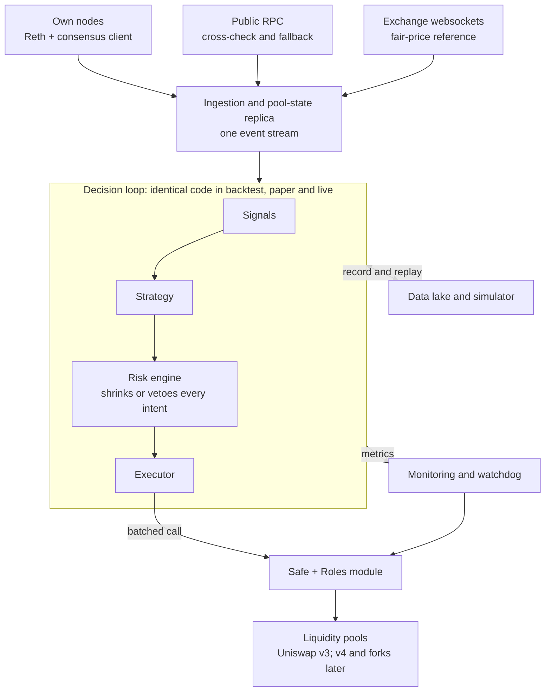

# Autonomous Uniswap v3 LP Bot — Full System Design

Exported from the design doc on 12 November 2026. When the design changes, change this file in the same pull request as the code.

## Summary

Build one Rust workspace with seven swappable modules that automates the play you already run by hand: place liquidity in price zones that get crossed often, enter in the token you value, and leave in that token with fees on top.

The decisions this design makes:

- **The core play is a round trip in your token.** Enter with ETH, or whichever token you value at the time, let the range trade it back and forth, and exit when the position is back in that token plus fees. All results and limits are counted in that token.
- **Blue-chip pools only, ranked by implied volatility.** The universe is WETH, WBTC, USDC and USDT. Pools are ranked by one number built from fee, volume and in-range liquidity.
- **Patience is an adaptive decision.** When price leaves the range, the bot does not recentre and lock in a loss. On each interval it weighs waiting, flipping and closing, using how price has behaved after similar exits on longer timeframes.
- **Every setting is adaptive.** Zone choice, width, fee tier and the patience decision are calibrated by walk-forward backtest, checked in simulation mode, and refined by small live positions.
- **Three run inputs.** Capital, a loss limit in the value token (required), and an autonomy mode: `auto` or `approve`.
- **Run a local node; treat public RPC as a cross-check.** One Ethereum node at home (Reth + a consensus client) covers the first phase and later anchors any L2 node. Public endpoints are rate-limited and cap log queries, so they serve as fallback and sanity check only.
- **Ethereum mainnet first.** Gas there is currently well under a dollar per action, the four tokens have their deepest pools there, and one local node is all it needs. L2s come later.
- **One strategy interface, three run modes.** The same strategy code runs in backtest, paper and live. Every run is defined by a YAML file and shown in one generic viewer.
- **Custody is a Safe with a roles module.** The Safe's owners control withdrawals, and the bot's hot key can only make allowlisted calls within quotas. No custom contract is deployed.
- **Venue-agnostic from day one.** Uniswap v3 is the first adapter. v4 and v3 forks (Aerodrome Slipstream, PancakeSwap v3) plug into the same interface.

This is an engineering design, not financial advice. Adaptive does not mean unbounded: a loss limit in the value token, given as an input to each run, sits under every adaptive decision as a hard backstop.

## The core play

The bot automates one move: put the token you value into a range that price crosses often, collect the fee on each crossing, and take the position out when it is back in that token.

The arbitrage-loss theory from the first draft is out of the decision logic. It remains only as an optional line in the results report.

**A round trip, step by step.** ETH is the value token here, in an ETH/USDC pool.

1. The zone finder picks a price zone that has been crossed often on long lookbacks.
2. The bot places ETH in a range inside that zone, above the current price. There the position is all ETH and needs no swap.
3. Price rises through the range. The pool sells your ETH for USDC and you earn the fee on that volume.
4. Price falls back through the range. The pool buys the ETH back and you earn the fee again.
5. Price is below the range. The position is all ETH again, the same amount as at entry, plus the fees. The bot withdraws, or leaves it in place for the next crossing.

For a different value token the picture mirrors: USDC goes into a range below the price.

**What a crossing pays.** A full pass of price through your range trades your whole position once, whatever other providers are doing. A round trip therefore pays about twice the fee tier on the position: 0.1% in a 0.05% pool, 0.6% in a 0.3% pool. Yield is that figure times round trips per day, which is why the choice of zone matters more than anything else.

Two trade-offs follow, and neither can be settled on paper:

- A narrower range is crossed in full more often, but price also spends more time beyond it.
- A higher fee tier pays more per pass, but its pool price typically moves in coarser steps and completes fewer passes.

**Two ways in.**

| Entry | How | Swap needed | Starts earning | Back in your token |
| --- | --- | --- | --- | --- |
| One-sided (default) | All of the value token in a range on the side price must travel into | No | When price enters the range | When price returns to the entry side |
| Around the price | Swap part into the other token and straddle the current price | Yes, at entry and usually at exit | Immediately | When price falls through the entry-side edge, or by a closing swap |

Both are built: `entry.shape` is `one_sided` (the default) or `around_price`. A range around the price is the one of the run's width, on the tick spacing, that holds the price and whose middle is nearest it. Measured in the value token it is not free of the trend: at entry it holds the other token in proportion to where the price sits in the range (half when centred), all of it once price runs past the range on the other token's side, none once price runs past on the value side. What it removes is the wait before the first fee, and with a time to move set (below) the stranding: the position is moved back around the price rather than waiting for price to return. A ladder of adjacent ranges on both sides of the price is not a third shape: in Uniswap v3, adjacent ranges with the same liquidity are one range, so it differs from a range around the price only in how liquidity is spread across it.

**The three outcomes of a one-sided ETH entry.**

| What price does | Position ends as | Counted in ETH | Bot's move |
| --- | --- | --- | --- |
| Crosses the range and returns | ETH | Entry amount plus fees | Withdraw, or stay for the next pass |
| Never reaches the range | ETH, untouched | Unchanged; nothing earned | Move closer when the zone map says so |
| Crosses and stays beyond | USDC, sold at about the middle of the range | Less ETH than at entry if bought back now | Patience policy |

**Patience decision (adaptive).** When price ends up beyond the range, nothing is fixed in advance: not the action and not the waiting time. On a set interval the bot compares three actions and takes the one with the best expected result in the value token. It never recentres by reflex.

| Action | What it does | Favoured when |
| --- | --- | --- |
| Wait | Leaves the position in place; it converts back and earns the fee again if price returns | Return odds are high for this distance and this time away |
| Flip | Moves the proceeds into a one-sided range next to the current price, on the side that buys the value token back | A return to the old range looks unlikely, but price is crossing a nearby zone |
| Close | Swaps back to the value token | Return odds are low and no nearby zone pays |

The comparison uses four inputs:

- **Return odds.** From the pool's own history: how often and how fast price came back after being this far beyond a range for this long, in a similar long-horizon state. This is where the longer time ranges enter a short-term position.
- **What a return pays.** The position back in the value token, plus the fee on the pass.
- **What waiting costs.** The yield the same capital would earn in the best zone available now.
- **What switching costs.** Gas, swap fee and price impact.

A switch needs a clear margin over the current course, so the bot does not flip back and forth. Every decision is scored afterwards against what the other two actions would have returned, and that score feeds the calibration below.

**How the first version computes it.** Each option becomes one figure: what it is expected to leave in the value token, looking ahead over a horizon.

| Option | If price makes the move in time | If it does not |
| --- | --- | --- |
| Wait | The position pays out its whole range in the value token, plus the fee on the pass | The swap back at the price history says it drifts to |
| Flip | The same amount sold through the range next to the price, plus the fee, less the gas of moving | The same swap back, less the gas of moving |
| Close | The swap back now, plus a share of what the freed capital would earn in the best range at hand | |

The odds of a move are counted, not modelled: over the lookback, from every ten-minute starting point, did price travel that many ticks in that direction within the horizon? The drift is the average change from the starting points that did not. Four settings govern the decision, and all four are fitted by the calibrator: the horizon, the lookback, the margin a switch must clear, and how much of the best range's yield is credited to closing.

What this version leaves out: the odds are the plain frequency over the lookback, not yet conditioned on how far price already is from the range, how long it has been away, or the long-horizon state of the market. A single large move in the lookback shifts them visibly. The decision table records what was expected, but decisions are not yet scored against the other two actions afterwards.

Two things stay outside the adaptive part:

- A loss limit in the value token, given as an input to each run. It is the backstop when history stops being a guide, which is exactly when return odds mislead.
- Fixed-rule baselines: always wait, always flip, always close. If the adaptive decision does not beat the best of them out of sample, the bot runs that fixed rule instead.

**Finding the zones.** A high-volatility range becomes something the bot can measure. For each candidate range and each lookback (7, 30 and 90 days) it computes:

- Full passes through the range per day.
- Share of time price spent inside it.
- How long price took to come back after leaving, as a median and a 90th percentile.
- How long a full pass waited for the pass back, as a median and a 90th percentile. This is the wait a position faces once price has run through it.

A full pass is counted when price goes from one side of the range to the other, however long it lingers inside on the way; dipping in and leaving on the same side is a visit, not a pass. Stays outside that the lookback cuts off are kept apart from the ones that ended, so an unfinished wait is never counted as a return.

Inside the top-ranked pools, zones are ranked by passes per day and by the implied volatility of the zone's own liquidity, marked down for long return times. The long lookbacks decide where to stand. The short ones decide when to enter and how long to expect to stay. That is the bot's version of looking at longer price ranges even when going in for a short time.

**How every setting adapts.** No setting is picked by hand or copied from past trades. Zone ranking, width, fee tier, entry shape and the patience margins all go through the same loop:

1. **Backtest.** A calibrator sweeps the settings on history, walk-forward: fit on one window, score on the next, in the value token.
2. **Simulation mode.** Settings that win run on live data with virtual positions.
3. **Live.** Settings that hold up get small real positions side by side. An allocator shifts capital toward what earns most per day, keeping a minimum share on the alternatives so it keeps learning.
4. **Feedback.** Results from simulation and live flow back into the next calibration run, on a schedule.

You can still pin any setting, or freeze the loop.

## Pool universe and ranking

The bot trades only pools whose two tokens are both on a short blue-chip list, and ranks them by implied volatility computed from fee, volume and in-range liquidity.

**Universe.** Four tokens: WETH, WBTC, USDC and USDT. No other wrapped or staked versions count. A pool qualifies only if both of its tokens are on the list. That leaves six pair types: ETH/USDC, ETH/USDT, BTC/USDC, BTC/USDT, ETH/BTC and USDC/USDT, across every fee tier on every configured chain. Pools are discovered from the factory's creation events, so new fee tiers or chains are picked up without a config change. The value token of a campaign is always one of the four.

**Ranking metric.** Implied volatility puts the three things you named into one number:

```latex
IV = 2\sqrt{\frac{f \cdot V}{L\sqrt{P}}}\;\times\;\sqrt{365}
```

| Symbol | Meaning | Where the bot reads it |
| --- | --- | --- |
| f | Fee tier, as a fraction | Pool constant |
| V | Volume per day, in the quote token | Summed from the pool's swap events |
| L | In-range liquidity, not the pool's total | The pool's active `liquidity` at the current tick; per tick from the state replica |
| P | Price, in the quote token | Pool price |

L√P is the in-range liquidity expressed in the quote token. It is about 100 times the value sitting within 1% of the price. An illustration with made-up numbers: a 0.05% pool with 100 million a day of volume and 5 million within 1% of the price has an implied volatility of about 38% a year.

The square of this number is proportional to fees paid per day per unit of in-range liquidity. Ranking by implied volatility is therefore ranking by what the pool pays the liquidity that is actually in range.

**Two versions are computed.**

| Version | Liquidity used | Volume used | Ranks |
| --- | --- | --- | --- |
| At the price | Active liquidity at the current tick | Pool volume over the window | Pools against each other |
| Per zone | Average liquidity across the ticks of the candidate range | Volume traded while price was inside that range, per day inside | Zones inside a pool |

The per-zone version is the one that matches the play, because the position sits in a chosen price range and competes only with the liquidity there.

**Floors before ranking.** A thin pool with a handful of trades shows a huge implied volatility that no real position could collect. Pools must clear a minimum volume and a minimum in-range liquidity first, and the bot caps its own share of the in-range liquidity so its entry does not dilute the number it ranked on. Volume is taken over 7 days as well as 24 hours, so one unusual day does not reorder the list. Daily volume is the average over the days actually stored in the window, with a warning when that is fewer than the window has; a pool with no stored day there is not ranked.

**How it feeds the rest.** The ranking picks the pools. Inside the top pools, the zone map picks the ranges, using passes per day and the per-zone implied volatility together. The ranking table, with fee, volume, in-range liquidity and implied volatility side by side for every qualifying pool, is refreshed on a schedule and shown in `lpbot status`.

## Architecture

Seven modules sit in one Rust workspace and talk through a single event stream, so any one of them can be replaced without touching the others.



Data flows down from the three sources into one normalized event stream. The decision loop is the same code in every run mode: in backtest it is fed from the data lake, in paper and live from the nodes. Only the executor differs, and only in live mode does it reach the Safe.

```text
lpbot/
  crates/
    core/        types, config, event bus
    chain/       RpcPool, ExEx and WebSocket ingestion, reorg handling
    venues/      uniswap_v3 (math, state replica, call encoder); later v4, slipstream
    data/        Parquet sinks, exchange feeds, backfill
    sim/         replay engine, cost models, P&L metrics
    strategy/    Strategy trait, signals, gates, range and rebalance policies
    risk/        limits, exit paths
    exec/        planner, simulator, signer client, submitter, journal
    cli/         the lpbot binary
  contracts/     roles policy as code, fork tests; optional vault later
  deploy/        docker-compose, Prometheus, Grafana
  config/        shared base configs (YAML)
  experiments/   one YAML file per experiment or sweep
  viewer/        Grafana dashboards over the result tables
```

Libraries this builds on: alloy for chain types and RPC, revm for local simulation, Reth's ExEx API for in-process ingestion, Polars and DuckDB for result tables, Grafana for viewing. Everything is Rust; there is no Python.

## Node and RPC layer

The first phase needs one machine at home running an Ethereum full node. L2 nodes are added only when the bot expands, and each of them needs this L1 node anyway.

**Why mainnet works as the first chain.** The base fee was about 0.05 gwei in early November 2026 with ETH near 2,300 dollars ([Dwellir](https://www.dwellir.com/blog/ethereum-gas-fees-explained)), and 0.445 gwei on 11 November with ETH at 2,076 dollars ([Etherscan](https://etherscan.io/gastracker)). At the higher of those, a position change of roughly 400,000 gas (my estimate) costs about 0.37 dollars. Gas does move: the daily average ran between 0.46 and 1.9 gwei from mid-August to mid-September 2026 ([CoinLaw](https://coinlaw.io/ethereum-gas-fees-statistics/)). The bot therefore prices gas before each action instead of assuming it stays low.

**Running it at home.** Plan a 4 TB NVMe drive, 32 GB of RAM, a wired connection and a small UPS. That is my sizing: it leaves room beyond Reth's stated full-node minimum for the consensus client, the data lake and growth. Forward only the peer-to-peer ports and never expose the RPC port. A power or internet cut at home leaves the bot blind, so the watchdog must run somewhere else and reach the chain through public endpoints.

| Chain | Client | Disk | RAM | Notes |
| --- | --- | --- | --- | --- |
| Ethereum | [Reth](https://reth.rs/run/system-requirements) + a consensus client | Full ≥ 1.2 TB, archive ≥ 2.8 TB (Reth docs, June 2025). A vendor measured a 2.31 TB archive on Storage V2 ([Dwellir](https://www.dwellir.com/blog/reth-explained)) | 8 GB+ full, 16 GB+ archive | Anchor for all L2 nodes |
| Arbitrum One | [Nitro](https://docs.arbitrum.io/run-arbitrum-node/run-full-node) | Pruned snapshot about 2.3 TB | Docs show a 64 GB machine as the example | Needs an L1 execution RPC and an L1 beacon URL. Has a sequencer feed |
| Base | [base-reth-node + base-consensus](https://github.com/base/node) | Full ≥ 2 TB, archive ≥ 4.1 TB (Reth docs, June 2025) | 32 GB minimum, 64 GB recommended ([Base docs](https://docs.base.org/base-chain/node-operators/performance-tuning)); Reth docs say 128 GB+ | Needs an L1 RPC and an L1 beacon endpoint. Heaviest of the three |

Sizes grow, so check current snapshot sizes before buying disks. Locally attached NVMe is required in practice; network storage falls behind.

**Full or archive.** A pruned full node keeps only recent receipts by default, so it cannot serve years of pool events. Two ways around that:

- Run Ethereum as an archive node and extract history locally with cryo or your reth-db-indexer (MDBX to Parquet). This is the fastest and cleanest backfill.
- Keep full nodes and backfill selected pools once with chunked `eth_getLogs` against public endpoints. It is slow but free, and the result is a static Parquet set you never fetch again.

**In-process ingestion.** Reth Execution Extensions (ExEx) run inside the node binary and receive committed, reverted and reorged chain notifications with receipts and state changes ([Paradigm](https://www.paradigm.xyz/2024/05/reth-exex)). That removes RPC from the hot read path on Ethereum and on Reth-based L2 clients. On Nitro, use the local WebSocket RPC plus the sequencer feed.

**The RPC pool.** All chain access goes through one `RpcPool` component with three tiers:

| Tier | Endpoint | Used for |
| --- | --- | --- |
| 0 | Local node: ExEx, IPC or WebSocket | Every read that feeds a decision; transaction simulation |
| 1 | Second own node, if you add one | Failover |
| 2 | Public endpoints (PublicNode, LlamaRPC, the chains' official RPCs) | Cross-check of head hash and pool price before each transaction; exit-only fallback; one-time backfill |

Rules the pool enforces:

- No decision is made on tier-2 data alone. Public endpoints rate-limit hard, cap `eth_getLogs` block ranges and often disable trace methods ([Chainstack](https://chainstack.com/learn/how-to/how-to-get-ethereum-rpc-endpoint-ai-agents-2026/)). One provider's keyless endpoint allows 2 requests per second per IP ([NodeFlare](https://nodeflare.app/chains)).
- If the local head lags a public head by more than a set number of blocks, the bot enters exit-only mode.
- If tier 0 is down, tier 2 may be used only to withdraw liquidity, with two endpoints agreeing on state.
- A rate limit (HTTP 429 or 5xx, or an error that says so) is retried with a doubling wait up to 30 seconds, honouring `Retry-After`. Only an answer that says the block range is too wide halves an `eth_getLogs` chunk.

**Sending transactions.** On Ethereum, submit through a private RPC. Flashbots Protect is permissionless and needs no API key ([benchmark study](https://arxiv.org/html/2505.19708v1)). On L2s, the local node forwards to the sequencer.

**You can defer the hardware.** The research phase runs on public endpoints and free exchange data alone. Buy or rent the node server only after a strategy passes the research gate.

## Data ingestion and storage

Three free streams feed everything: pool events from your node, reference prices from exchange websockets, and block gas data. They land in Parquet for research and Postgres for bot state.

| Stream | Source | Live method | Backfill method | Used for |
| --- | --- | --- | --- | --- |
| Pool events: Initialize, Mint, Burn, Swap, Collect, Flash, protocol-fee changes | Own node | ExEx notifications or `eth_subscribe` logs | cryo, reth-db-indexer, or chunked `eth_getLogs` | Pool state, fee accrual, flow analysis |
| Pool discovery: factory `PoolCreated` | Own node | Same | Same | Pool universe and screening |
| Block headers: base fee, timestamp, L2 data-fee parameters | Own node | New-head subscription | Same extract | Gas cost model |
| Trades and best bid/offer for the same pairs | Binance, Coinbase, OKX public websockets (no key) | Websocket | Exchange bulk history files | Fair price, realized volatility, markouts |
| Own transactions and receipts | Own node | Executor journal | n/a | P&L attribution, reconciliation |

**Pool-state replica.** For each watched pool the ingester keeps an exact in-memory copy of the contract state: `sqrtPriceX96`, tick, active liquidity, net liquidity per initialized tick, global and per-tick fee growth, and the protocol-fee setting. Mint and Burn events update the tick map. Each Swap is replayed through a port of the pool's integer math, which reproduces fee growth across tick crossings exactly. Three safeguards keep it honest:

- A snapshot to disk every few thousand blocks, so restart does not replay from genesis.
- A periodic checksum against on-chain `slot0`, `liquidity` and `ticks()`. A mismatch halts trading on that pool.
- A way back from reorgs near the head. What is stored is read at or behind the finalized block, where no reorg reaches. What follows the head (`lpbot watch-pools`, below) keeps two states: one at the newest finalized block, and one at the head, with the blocks between kept with their hashes and logs. Each step checks that the block it stands on is still the node's; when it is not, the head state is rebuilt from the finalized one and the kept blocks still on the chain, and the rest is fetched again. On L2s, track unsafe, safe and finalized heads separately.

Every change to the replica is all-or-nothing: a mint, burn, flash or swap that fails leaves the state as it was, and the step observer sees a swap's steps only once it has succeeded. A virtual position's bounds are *watched* ticks: swap steps split there so the position's share of each step is exact, but the contract has no such tick. Watched ticks keep their own fee growth outside, apart from the contract's, and every swap ends at the tick the contract would hold, in both directions.

Read the protocol-fee setting per pool. Uniswap's fee switch now applies to v2 and select v3 pools, which lowers the LP share there ([The Defiant](https://thedefiant.io/news/defi/uniswap-protocol-revenue-nearly-triples-after-v4-fee-switch-as-uni-tops-usd4)).

**Storage layout.**

| Layer | Technology | Contents |
| --- | --- | --- |
| Raw lake | Parquet, partitioned by chain, pool and day | `events`, `blocks`, `cex_trades`, `cex_bbo` |
| Derived | DuckDB views (ClickHouse and dbt if it outgrows one machine) | `zone_map`, `pool_minute_bars`, `tick_liquidity_snapshots`, `return_times`, `realized_vol` |
| Operational | Postgres | `positions`, `intents`, `tx_journal`, `risk_events`, `strategy_state`, `config_versions` |
| Event bus | In-process channels first; NATS only if modules split into separate processes | Normalized `Event` stream consumed by signals, strategies, risk and monitoring |

**How the raw lake is laid out.** Pool logs are stored raw, with their topics and data and the time of their block, so the replica replays exactly what the chain emitted and a new event type needs no new backfill:

```text
<data>/events/chain=<chain>/pool=<address>/day=<YYYY-MM-DD>/events.parquet
<data>/snapshots/chain=<chain>/pool=<address>/day=<YYYY-MM-DD>.json
<data>/manager/events/chain=<chain>/pool=<position manager>/day=<YYYY-MM-DD>/events.parquet
<data>/live/checkpoint-<chain>.json
```

The `manager` folder holds the position manager's own logs (`IncreaseLiquidity`, `DecreaseLiquidity`, `Collect`, `Transfer`), which following position NFTs needs; `lpbot watch-pools` stores the days it needs the first time, four at a time. `live` holds its checkpoint.

A day is a UTC day. A finished day is written once and never touched again; the day in progress is kept as `events.partial.parquet` and rewritten by the next backfill, so a re-run fetches only what is new. A day counts as finished only once its last block is at or behind the node's finalized block (a few blocks behind the head, with a warning, on a node that does not serve the `finalized` tag). The catch-up before a look of a forward run in the agent mode stores the day in progress further, up to the head; such a day still counts as finished only once its last block is final, and until then every catch-up reads it again whole. One backfill run reads one head and stores every pool up to it. It goes day by day, not pool by pool: each day's logs of every pool that still needs the day come from one `eth_getLogs` request per chunk, naming all those pools, and are split by pool on our side. The node reads a block's receipts once however many pools a request names, so a first backfill of the 24-pool universe costs about what its busiest pool alone does; one pool at a time took about 7 hours on the owner's node in November 2026, most of it the node reading the same blocks again for each pool. A pool that cannot start (its state unreadable) fails alone and the others go on; a failure of the node stops the run, and a re-run carries on from what is stored. The snapshot for a day is the pool's full state right before that day's first block, the point every replay starts from; a re-run reuses the newest stored snapshot when every day from it on is stored, instead of taking a new one each day. A pool created after the start asked for is stored from its first whole day. Reading a range of days fails on a missing day, so a gap is never mistaken for a quiet day.

Writes survive a power cut: each file goes to a temporary name of its own, is synced, renamed into place, and its folder synced. A file found empty or cut short (no Parquet footer, or JSON that does not parse) counts as missing, so the next backfill fetches it again; it is renamed to `<name>.damaged` and named on the error output.

**Following the pools live.** `lpbot watch-pools`, run as the watcher service, keeps every stored pool current from the local node. It starts from its checkpoint, or the first time from the stored history: each pool's snapshot and stored days and the position manager's days, merged in chain order and replayed day by day. Then it polls the node every two seconds over HTTP: the newest header, the finalized block, the headers of the new blocks, and in one `eth_getLogs` every log of the pools and the position manager in them, each log checked against its block's hash. New blocks are applied to the head state; blocks at or behind the finalized one move into the finalized state, which is saved as the checkpoint every ten minutes. A reorg is handled as above. Catching up after a stop goes 500 blocks per step. Polling HTTP stands in for ExEx or WebSocket notifications for now: a block comes every 12 seconds, and the cost is three small requests per poll.

**Positions.** The watcher follows every position of the followed pools, as the contracts account for them:

- *Pool positions*, by owner and range, from the pool's `Mint`, `Burn` and `Collect`: liquidity, the fee growth inside the range when last touched, and what the pool owes. Fees are credited exactly as the pool does before every change, with the fee growth read after a mint sets up its ticks and before a burn clears them.
- *Position NFTs*, from the position manager's `IncreaseLiquidity`, `DecreaseLiquidity`, `Collect` and `Transfer`. An NFT event names only its token; the manager's pool event just before it in the same transaction (same liquidity for an increase or decrease) says which pool and range. Each NFT's fees are credited at the fee growth the manager reads, its own pool position's. The manager's pool positions are the NFTs added up and are not shown.

A position the book meets for the first time may have held something before the history began. Unless it is minting into a range no one holds (then it starts from nothing), it is read from the node after the block before its first event: `positions(key)` from the pool, `positions(tokenId)` and `ownerOf` from the manager. From then on it is followed exactly. A position emptied and collected leaves the book and starts from nothing when used again, as on the chain. What the book cannot see is a position that held liquidity before the history began and that nobody has touched since: its liquidity stays unattributed, and each pool reports the share of its active liquidity that the book attributes. Something that does not add up (a burn of more than the book knew of) is counted and shown, never a reason to stop.

**The table that matters most: the zone map.** For each pool it holds a grid of candidate ranges by lookback, with full passes per day, share of time in range, and the spread of return times after price leaves. It is updated incrementally from pool prices and drives zone choice and the patience policy. Markouts and arbitrage-loss figures can be added later as diagnostics; nothing depends on them.

## Simulation and backtesting

The backtester replays real pool events through the same pool math and the same strategy code that run live, and inserts your position as a virtual one. If the simulator is wrong, everything downstream is wrong, so it is validated against real positions before any strategy result is trusted.

How a run works:

1. Load the pool snapshot at the start block and the event stream for the window.
2. Apply each block's events in log order. After each block, pass the state to the strategy. Everything that matters is decided and counted block by block, at the time of the block: stops, the loss limit and the campaign exits are checked after every block; the time a position spends in its range is counted from one block to the next (`seconds_in_range` on each campaign, and the run's seconds in range, out of range and flat), not from the sampled series; fees accrue swap by swap. What runs on a clock is the strategy's own pace, each setting a duration down to one block (12 seconds): `entry.check_every` (how often a flat run looks for an entry, an hour by default), `patience.decide_every`, and the signals. The signals count on the price thinned into steps of `signal_step` (ten minutes by default, down to one block); the volatility looks back `entry.vol_window` (a day by default) and is per day whatever the window; zone lookbacks are durations, such as `[1h, 1d]` for intraday ranges, and each is measured again every twelfth of its length (at least every minute, at most once a day). The series table is a sample for the charts, every `sim.series_every` (an hour by default); an experiment sets it shorter with its `set` block. A duration, here and on the command line (`--next`, `--wait` and the others), is a whole number with a unit, `s`, `m`, `h` or `d`, or several such from the largest unit down, each unit once: `90s`, `4h30m`, `1d12h`.
3. Execute any action the strategy returns at a later block (latency parameter, at least one block), at the state then. This prevents look-ahead.
4. Accrue fees to the virtual position from the change in fee growth inside its range, times its liquidity. In practice the position takes its pro-rata share of each swap step's fee, which is the same quantity, with its own liquidity counted in the step's active liquidity: `fee × L_pos / (L_pool + L_pos)`, so it can never earn more than the pool paid. A flash loan paid while the price is inside the range pays the position its share the same way, after the protocol's cut.
5. Charge costs: gas for each action (plus the L1 data fee on L2s), swap fee and price impact for rebalance swaps, and the pool's protocol fee. Swaps are run against a copy of the pool, so fee and impact are exact. Gas is charged at the price of the block the action lands in (`costs.gas: chain`, the default): that block's base fee plus a priority fee: by default (`costs.priority_fee_gwei: median`) the median of the median tips of that block and the 19 before it, as a wallet sets it (a block with a handful of transactions can show a median tip of thousands of gwei, which no sender would pay), or one of the config's own. `lpbot gas-history --from <day>` reads both from the node's fee history, 1,024 blocks a request, into `gas/chain=<chain>/blocks=<first>.parquet` files of 100,000 blocks, up to the finalized block; the chunk at the head is `.partial` until it is whole. A forward run's catch-up stores the head chunk up to the head itself: a partial chunk then records the last of its blocks that was final, the next fetch keeps those and reads only the rest, and a chunk is written whole only once its last block is final. A run whose blocks are not all stored refuses to start and says so. In a pool that holds WETH the ETH the gas costs is turned into the value token at the pool's price at that moment; elsewhere at `costs.eth_price_usd`. `costs.gas: fixed` charges `costs.gas_price_gwei` on every block, as runs before 20 November 2026 did, at 1 gwei. That was neither high nor low throughout: the median block paid about 1.3 to 1.8 gwei with its tip from May to July 2025, with spikes of several gwei at the busiest hours, and 0.05 to 0.3 gwei from December 2025 on, so the fixed price undercharged the first months of the long window and overcharged the last year three to ten times. The runs table says which (`gas_prices`) and the average price paid (`gas_gwei`).
6. Mark the position each block and write the P&L breakdown. The mark is the pool's own price after its swap fee for now; the exchange mid-price replaces it when the exchange feeds exist.

**Two fill models.** *Passive* assumes your liquidity is small against active liquidity, so historical swaps are unchanged and you take a pro-rata fee share. *Impact* re-runs swaps with your liquidity added and regenerates arbitrage flow from the exchange price path. Use passive first. Switch to impact once your size exceeds a few percent of active liquidity in the range. Until the impact model exists, an entry is shrunk to `universe.max_share_of_in_range_liquidity` of the thinnest active liquidity anywhere in its range, read from the replica's tick map; the rest stays as cash, and the run's summary counts the capped entries. The cap applies to entries, not to flip legs, and a range with a gap in liquidity gets no entry.

**What the first version trades.** The zone round trip, with the adaptive patience decision or one of the three fixed rules, on one pool per run:

- *Pool.* The stored pool holding the value token that ranks highest by implied volatility over the week before the window, unless the strategy names a `pool`. The floors are enforced: when no stored pool clears them, the run is refused with each pool's reason and what to do. A named pool is traded even below the floors, with a warning. Sweeping `pool` compares fee tiers; each run trades the pool it names.
- *Entry.* One-sided in the value token (`entry.shape: one_sided`), in a range of the run's width within `entry.max_gap_ticks` of the price (one width by default). Among those ranges it takes the one crossed most on the longest lookback, provided it was also crossed on the shortest and at least `entry.min_passes_per_day` times a day on the longest (0 by default, which lets any range crossed lately qualify). Without enough history, a day of it or the whole longest lookback when that is shorter, it takes the nearest. The minimum exists because of what the first real backtests showed: on 6 June 2026 ETH wicked to about $1,520 for an hour, the wick itself counted as a crossing on the 7-day lookback, every run that was flat then entered a range just above the wick, and price never came back; one such campaign held its capital in dollars for 148 days and cost more than all the round trips earned.
- *Entry around the price* (`entry.shape: around_price`). The range of the run's width centred on the price, provided it was crossed at least `entry.min_passes_per_day` times a day on the longest lookback. The entry swaps the share of the value token the range holds in the other token at the pool price, against a copy of the pool so the fee and impact are the real ones, and adds the liquidity both amounts then buy; the swap fee leaves a little of the value token over, which stays as cash. The amounts are integer math throughout. The cap on the share of the liquidity in the range applies before the swap, so what it holds back is not swapped. Gas is an open and a swap. Leaving the middle of the range for the first time is half a pass; passes are counted from one side of the range to the other as before. Once price has left the range the position is one-sided and follows the rules below: back in the value token it waits within the gap and is otherwise withdrawn and entered again around the price (another range is never counted busier, as reaching it would take a swap); in the other token it goes to the patience decision.
  - `exit.recenter_after`: an around-price position wholly in one token for this long (0: at once) is moved to the range around the price at the next `patience.decide_every`, swapping only what the new range needs: close, open and one swap of gas. The campaign goes on (its `recentres` counts the moves) and the move is recorded as a `recenter` decision with the range it went to; a move whose new range cannot open closes the campaign as `recenter_failed`. While it is set, a resting position is not moved by the gap rule, and the patience rule still answers until the time is up. It needs `entry.shape: around_price`; a run that sets it on a one-sided shape is refused.
- *When to be in.* Optional gates, all off by default, decide whether a campaign starts at all, so the bot is in only while conditions favour the range and back in once they do again:
  - `entry.max_vol_to_width`: the day's realized volatility, in ticks, at most this many times the range width. The volatility is the engine's own: the standard deviation of the price's change from one `signal_step` bucket to the next over `entry.vol_window`, scaled to a day, from the events it has replayed, so backtest and live measure it alike. A gate with less than an hour of history keeps the bot out.
  - `entry.max_daily_vol_pct`: the same volatility at most this many percent.
  - `entry.min_gas_multiple`: an entry must put in at least this many times the gas of its open, close and one swap, or it is not made. The cap on the share of the liquidity in the range can shrink an entry to a few dollars in a thin pool, where gas then eats it.
  - `exit.max_vol_to_width`: a resting position (wholly back in the value token) steps aside to cash when the day's volatility exceeds this many range widths; the campaign ends as `stepped_aside`. Alone it churns: the bot steps back in at the next look. Paired with an entry gate at or below it, it stays out until the day calms down.

  - `entry.after_move_pct`, `entry.move_window` (4 hours by default) and `entry.move_direction` (`any`, `up` or `down`, as the volatile token's dollar price): a campaign starts only after price has moved at least that much over the window, measured close to close on the engine's `signal_step` buckets that have ended. It is the signal for providing liquidity where volume gathers after a fast move, near a possible top or bottom, usually with a stop and a time limit below.
  - `entry.cooldown`: after a campaign ends, no new one starts for this long. Looking often (`entry.check_every` of minutes), the move signal stays true for hours after it first fires, and without a wait the run enters the same move again after every exit, taking the same stop each time: one entry per move.
  - `entry.reposition` (`true` by default): a resting range price has moved away from (farther than the gap) or that a much busier range has outranked is withdrawn and entered again where the zone choice now says (`repositioned`). With `false` a range stays where it was placed until an exit takes it out: an order that did not fill waits for its time limit instead of following the price. In the first selective grid (20 November 2026) 57% to 65% of all campaigns ended by being moved, each paying gas and entering closer to a price that was still running.
  - `entry.width_vol_multiple`: a new range is this many times the day's realized volatility wide, rounded up to the tick spacing, instead of `entry.width_ticks`, which is used until there is a day's history to measure. A position keeps the width it opened with; every rule that compares a position to a width uses its own.

  These follow what the first scan of real history showed (19 November 2026, 168,000 campaigns): a campaign's result depended most on the day's volatility at entry against the range width. Ranges whose width was small against the day's volatility lost; wide ones in calm days earned. The worst losses started where volatility was 90 to 130 widths, and the instant ones were positions of a few dollars that gas consumed.
- *Staying.* A position that is back in the value token stays for the next pass. It moves only when price has drifted further than the gap allows, or when another range is crossed `entry.move_margin` times as often (1.5 by default). Zone scores are kept for a day, so within the first day of history a range scored before it was crossed still counts as never crossed.
- *Beyond the range.* Every `patience.decide_every` the policy answers: wait, flip into the range next to the price, or close. With `patience.max_wait` set, a position wholly in the other token that long is closed whatever the policy says, recorded as a `close` decision and ending the campaign as `patience_timeout`; it caps how long a wait can strand the capital. A price exactly on the far bound counts as beyond, as the position's holdings do. A flipped position that price leaves behind by a full width gets the same question again. The decision row records the range the flip actually went to. A flip whose new leg cannot open ends the campaign as `flip_failed`. What the new range cannot take stays in the other token and goes back with the campaign's closing swap, which is charged.
- *Each campaign's own exits.* Checked on every block before anything else the campaign might do, all off by default. Each closes the campaign back to the value token, at a loss if need be, and the bot looks for its next entry at the next check:
  - `exit.max_hold`: open this long (`max_hold`), for positions from minutes to weeks.
  - `exit.max_loss_pct`: the campaign has fallen this many percent below what went in (`stop_loss`). Its value is the run's equity, marked at the pool price after the swap fee and net of gas, less what stayed outside it.
  - `exit.max_drawdown_pct`: it has fallen by this many percent of what went in from its best since entry (`trailing_stop`).
  - `exit.exit_on_return_pct`: once price has run this far past the range on the other token's side, the campaign is closed as soon as price is back in the range (`return_exit`), taking what the return gives back rather than waiting for a full pass.
  - `exit.after_round_trips`: the campaign is closed once it has come back wholly into the value token after being wholly in the other one this many times (`round_trip_exit`; 1 is the first round trip): the value token back, the fees of two passes on top.
- *The agent mode* (`strategy.agent.decisions`). Entries and exits are decided look by look by someone looking at the pool, a person or a Claude Code session working in the repository, not by a rule and not through a model's API. `lpbot agent next <experiment>` replays the run from its decisions up to the first look that has none and shows the pool there: for 15 minutes, an hour, four hours, a day, a week, 30 and 90 days, how far the volatile token's price moved, its highest and lowest price, the realized volatility per day, the swaps and the volume against the 30-day pace; the fee, the tick spacing, the gas and what entering and leaving cost; the run's result so far; and the open position with its range, state, time held, result and fees. Prices are in percent from the price at the look, with no dates and no price levels. `lpbot agent decide <experiment> --action stay_out|hold|exit|enter [--lower <pct> --upper <pct>] --next <duration> --note "why" --reasoning "..."` writes the decision for that look to the decisions file, one JSON object a line keyed by the look's time, and shows the next look, named by its number and day in the run, never its time. An entry is the range between two prices in percent from now: wholly on the value token's side it is one-sided, anywhere else the value token is swapped into its mix; entering another range while a position is open moves it (closed, then opened). The engine carries the decisions out with its own sizing, gas, latency and share cap, and the campaign exits and the loss limit still apply between looks. The run is replayed from the file every time, so a finished session is an ordinary run: `lpbot run` on the experiment writes the six tables, and a decision that no longer answers the look asked (the settings or the history changed) is left out and reported. The decisions file lives under `data/agent/` and is not committed. Next to it, `decide` keeps the run's reasoning log (`my-run.jsonl` keeps it in `my-run.log.md`): for each decision, in Markdown, the look as it was shown, the decision, the one-line note and the reasoning given with `--reasoning`, as long as it needs to be. The run never reads the log, and it stays local with the decisions; it is there so whoever decides keeps the thread across looks, and so the run can be read afterwards decision by decision. A session deciding over a stretch of history its model may have seen in training, or results of which it has read, is not a clean test: the clean one is forward, at the head of the chain.
- *Forward runs in the agent mode* (`window: { from: <day>, to: open }`, such as `experiments/agent-usdc-weth-forward.yml`). The window is open at the end: the run goes as far as the stored history does, and stays `mode: backtest`, replayed from its decisions every time, so `lpbot run` writes its six tables up to the newest stored block. Before each look, `agent next` and `agent decide` bring the run's pool and the gas prices up to the node's head (`agent_cmd::sync`; `--no-sync` replays what is stored): the days of its history not yet stored complete, then the day in progress up to five blocks behind the head, and while the node is still syncing no further than the block it has executed (Reth's block number runs ahead with its headers). A day of events, or a chunk of gas prices, is closed only once its last block is final; what is past the finalized block is read again by the next catch-up, the day whole and the gas chunk from the last block it records as final. A look that is due and not yet decided is shown at the newest stored block (`Settings::agent_forward`) rather than at the first block at or after its time, so a session that comes back late sees the pool as it is now. Its decision records the time of that block (`at`) beside the look's time, and the wall-clock time it was written (`decided`, kept for the record); the replay carries it out from the first block at or after `at`, never at a price from before the look was seen. The decision's latency is not charged: it acts at the block of its look, as in a backtest, however long the session took to decide. A look is shown only while the newest block is at most `--max-lag` old by the wall clock (5 minutes): a node behind the chain, as after the internet outage of November 2026, gives no look, only the refusal and what to check. When no look is due yet, `agent next` says by the wall clock when it is (`Next look due: <time>Z`), and `agent next --wait <duration>` waits for it, brings the store up again and shows it. A forward run names its pool (`pool:`), which is what the catch-up stores. `lpbot agent evaluate` scores a forward run from where each look was seen: a decision and its alternatives start at the block of its `at`, the span to the next look ends where that look was seen, a fixed horizon ends when it is due, and nothing ends past the newest stored block. Where it runs and how the deciding session comes back at each look are in `deploy/RUNBOOK.md`, "A forward run in the agent mode".
- *Following a provider* (`strategy.follow`). Instead of choosing its own ranges, a run can copy a real liquidity provider's: `lpbot lp-positions --nft <id>` or `--account <address>` reads from the node, through the Uniswap v3 position manager, every NFT the owner received since a day (minted or sent to it), when it arrived and left, its pool and range (`positions(tokenId)` at its first event), and every change of its liquidity and every collection, one row per stretch with liquidity in place, for the stored pools (a CSV under `data/follow/`, not committed). Each NFT's events are read over its own lifetime, so a provider that opens a new position every day is read a few days at a time. With `strategy.follow.file` (and `owner` to pick one provider), the run enters each of the provider's positions on its pool in the same range, swapping the value token into the range's mix wherever the price is, when the provider opens it, provided it is joined within `strategy.follow.join_within` (an hour by default) of that, and closes it back to the value token when the provider takes the last of the liquidity out (`leader_exit`). One position is copied at a time, and those opened while one is copied are missed. Patience and moves do not apply; the campaign exits do. The run's capital, latency, gas and share cap are its own, so the result answers what copying the provider would have earned at this size, not what the provider earned.
- *Loss limit.* Checked on every block against the run's starting capital, position marked at the pool price, net of any gas still owed. When hit, everything is closed and the run stops. `risk.loss_window` in the config is not read yet.

All of these are the fixed starting point the calibrator has to beat, not tuned choices.

**Outputs per run.** Per campaign and in total, counted in the value token: amount in, amount out, fees, days held, passes completed, time spent beyond the range, gas and swap cost. Each run is compared with simply holding the value token. Every run is also counted in dollars, with the pool's dollar stable at one dollar: its capital at the pool price when trading starts and when it ends, the result in dollars, and what simply holding the value token did in dollars (the price change for ETH, nothing for a stable); the series carries the value and the hold line in dollars hour by hour. An arbitrage-loss figure is available as an optional diagnostic.

**Calibration, not hand-tuning.** A calibrator reruns the simulator on a schedule across the search space of settings: zone ranking weights, width, fee tier, entry shape and patience margins. It fits on one window and scores on the next. A setting is promoted to simulation mode only if it beats both the one currently running and the fixed-rule baselines on the scoring window. The first version calibrates the patience decision only: 18 combinations of horizon, margin and credit per fold, the adaptive decision shipping only if its out-of-sample results, summed over the folds, beat every fixed rule. Width and fee tier are compared by sweeping them in the experiment file. Running it on a schedule and promoting into simulation mode come with paper mode. Simulation mode (`paper` in the config) then runs it on live data before any capital follows.

**Validation, in order of importance.**

- Reproduce the fees actually collected by at least 20 real historical positions in the pool, to within 0.1%. `lpbot verify-fees` does this from the stored logs and the node: it follows every position that the pool's `positions()` shows empty and owing nothing at the start of the history, adds up what the replica's fee growth says the pool owed it, and checks that what it collected plus what the pool still owes it at the end equals that. Without a node the agreements it finds are counted as unverified, never as confirmations.
- Differential-test the math port against the deployed pool on a local fork (revm or anvil) with randomized swaps and mints. Not built yet: the reference vectors and `lpbot verify-pool` against the node are the independent checks so far.
- Compare one stored day of a pool, log for log, with a public endpoint: the newest complete day that has logs, so the check cannot pass on an empty day. Replaying the stored events to the pool's state on the chain cannot see a missing event that changes no state, such as a `Collect`; this can. It is the one use of a public endpoint in the research pipeline, and nothing is decided on its data: it only confirms or contradicts what the local node gave.
- Walk-forward only: fit parameters on one window, score on the next. Never report in-sample results.
- Choose pools by a rule fixed in advance, not by looking at which pools did well.

**Paper mode.** The same engine runs on the live event stream with virtual positions and real gas quotes. Its P&L is the yardstick for the live bot later: live results that drift from paper results mean an execution or modeling fault.

## Several agents in the agent mode

In the agent mode one person or session decides a run. A panel puts several deciders on the same run, each in a run of its own: Claude Code sessions of different models, or people. Each publishes its reasoning for every look in a form the others and the tools can read. Every decision is scored afterwards against what happened and against the actions not taken. An agent can read the others' reasoning and decide its own way, and in forward and live runs it can ask them before it decides. One rule about time keeps this a test and not a leak, and the tools enforce it.

**Roles.**

| Role | Who | Does | Reads |
| --- | --- | --- | --- |
| Owner | A person | Sets up the panel (the experiment, the agents, their models, who reads whom), starts each agent with its brief (`lpbot agent brief`), compares the runs | Everything |
| Decider | A session of a named model, or a person | Decides one run look by look | Only what `lpbot agent` prints for its run |
| Reader | A decider whose panel entry names peers | Reads its peers' records at its looks, and says how its decision relates to them | Its peers' records, handed over up to its look |
| Advisor | Any agent of a forward or live panel | Answers the questions others ask at a look | The question and the asker's look; the chain head, as anyone does |
| Reviewer | A session or a person, once a run is over | Evaluates another agent's log, blind first | The finished log and its scores, a step at a time |
| Scorer | `lpbot agent evaluate` | Scores every decision against what happened and the actions not taken, the same way for every agent | The decisions and the pool history |

**A panel is one experiment.** Each agent's run is one run of the experiment, swept over whole `agent` entries, so the pool, window, capital, loss limit and costs are the same for all and only the decider differs:

```yaml
sweep:
  agent:
    - { name: a, model: claude-haiku-5-5, decisions: data/agent/panel-x/a.jsonl }
    - { name: b, model: claude-sonnet-5-5, decisions: data/agent/panel-x/b.jsonl, peers: [a] }
```

`--agent b` picks b's run for every `lpbot agent` command. `name` is the agent's handle and names its decisions file (`b.jsonl` for `b`). `model` is the Claude model id of the session, or `person`. `peers` are the agents whose records it is handed: by name, in the same folder, or by path (`data/agent/panel-w/a`) for an agent of an earlier panel. `lpbot run` on the experiment writes the six tables for every agent's run, so the runs dashboards compare them like any runs. A panel's files share one folder under `data/agent/`, which is never committed:

| File | Written by | Holds |
| --- | --- | --- |
| `<name>.jsonl` | `agent decide` | The decisions: the run itself |
| `<name>.log.md` | `agent decide` | The reasoning log, for people |
| `<name>.log.jsonl` | `agent decide` | The same, one JSON record a look, for agents and tools |
| `<name>.eval.jsonl` | `agent evaluate` | One score per decision and horizon |
| `<name>.review-<reviewer>.jsonl` | `agent review` (not built) | Another agent's evaluation of the log |
| `board.jsonl` | `agent ask`, `agent answer` (forward and live panels) | Questions and answers, shared by the panel's agents |

**The record of a look.** `agent decide` appends one JSON object a line to `<name>.log.jsonl`, next to the Markdown entry. Every record names its schema (`"schema": "lpbot.agent/1"`) and its kind (`"kind": "look"`), and holds:

- who wrote it: `agent`, `model`, `experiment`, `run_id`, `pool`, `value_token`;
- when: `look` (the look's time, the key of the decisions file), `number` and `day` in the run, `block`, and `as_of` (below);
- what it saw: `seen`, the observation as numbers (every time scale, the fee, gas, the run so far, the position), and `seen_text`, as it was printed;
- what it decided: `decision` (`action`, `lower_pct` and `upper_pct` for an entry, `next`), the `note` and the `reasoning`;
- what it expected: `expect`, a band of prices (`low_pct` to `high_pct`, in percent from the price at the look) it expects price to stay within until its next look, how sure it is (`confidence`, 0 to 1), and the expectation in words (`text`). `decide` takes them as `--expect-low`, `--expect-high`, `--expect-confidence` and `--expect`;
- what it read: `shown`, the peers' records handed to it at this look, and `stance`: `own` (decided without regard to them), `copy`, `adapt` or `depart`, `toward` a peer (`--stance`, `--toward`). A look that handed over peers' records refuses a decision without a stance. The reasoning says why.

Other kinds share the schema and the rule below: `eval`, from the scorer; `ask` and `answer`, on a forward or live panel's board; and once built, `strategy` (the rules an agent says it follows, rewritten when it changes them) and `review`.

**The rule about time.** Every record carries `as_of`: the latest moment whose market its author could have seen. A look's record is as of the block the look was shown at; in a forward run, where showing the look again moves it to the newer head, the block it was last shown at before it was decided. A score is as of the end of the stretch it scores. A review, a strategy note, a question or an answer is as of its author's look when it was written (in forward runs, the chain head then). An agent at a look shown at time *t* is handed only records as of *t* or earlier, and only by the tools:

- `agent next` prints, after the look, the peers' records as of *t* or earlier that its earlier looks were not handed, among them the scores of the peers' earlier decisions whose horizon has passed, and records a peer that was behind has written since;
- `agent peers` prints all of them again, up to the look waiting for a decision.

Records are shown by look number, day in the run and how long before the current look, never by time or block. Their prices stay in percent from the price at their own look. A handover therefore tells no more about the date than the agent's own look does. A peer that is behind (a backtest run at the same time, or a run not yet finished) shows fewer records, never later ones. A run can read an agent of an earlier panel by the same rule: it is handed that agent's records as of before each look, which is all of them once the earlier window ended before the new one began.

The tools enforce the rule for what they hand over. The rest is in the brief. A deciding agent reads only what `lpbot agent` prints for its run. It does not open the experiment file (it names the window), `config/`, the files under `data/` or `runs/`, `docs/RESEARCH.md`, the result tables or the price history of its window, and it does not look up prices or news. `lpbot agent brief <experiment> --agent <name>` prints the role, the commands and these rules for a session, and names no dates. A backtest over months the model may have seen in training is still not a clean test. Forward, at the chain head, is.

**Scoring decisions.** The `decisions` table holds what a rule expected, not what came of it. `lpbot agent evaluate <experiment> [--agent <name>] [--horizons next,1d]` scores every decision of an agent run the same way for every agent, from the decisions and the pool history alone. It needs no log, so runs from before the log existed can be scored too. For each decision it replays the run to that look. From that state it runs each action the agent could have taken, left alone for the horizon: the decision as made; cash (stay out, or exit what is open); and, with a position open, holding it as it is. The same engine carries them out, with the same gas, latency, share cap, stops and loss limit. A horizon is `next` (until the agent's own next look) or a duration. One that runs past the window ends with it, everything closed. Each score gives:

- the change of the run's equity over the horizon for each alternative, in percent of the capital, in the value token;
- which alternative was best, the regret (the best less the decision), and the decision's edge over cash and over holding;
- what price did over the horizon: its change, highest and lowest, in percent from the price at the look;
- for `next`, whether the expected band held, and the Brier score of the confidence given for it.

The scores go to `<name>.eval.jsonl` (kind `eval`, as of the end of the horizon). The command prints each agent's summary: the run's result against holding the value token and in dollars, campaigns, fees and gas, and for each horizon the mean edge over cash and over holding, the total regret, the share of decisions that were the best, the band's hit rate and the mean Brier score. With several agents it prints them side by side.

A score values one decision left alone. The run's own result is what the decisions did together. An entry pays its gas at once and earns over time, so a short horizon is hard on it: score `next` and at least a day. Ranges the agent did not choose are not searched; in hindsight every entry would lose to the best range. Each alternative is a replay from the start of the stored history: the history is read once and the replays run on every core, about three a decision and horizon. Forking the engine at the look would make it one pass. It is not built.

**Reviews, blind first (not built).** An agent evaluating another's log must form its own view before it sees the first agent's. `agent review next <experiment> --agent <reviewer> --of <name>` shows the reviewer the next look of the log as its author saw it, with the decision, but without the note, reasoning, expectation or score. The reviewer writes what it would have done and why (`agent review write --would <action> --own "..."`). Only then does the tool show the author's reasoning and the scores, and the reviewer writes its verdict (`--verdict agree|disagree|unclear --why "..."`). The record keeps both parts, as of the end of the scored horizon, so a decider is handed a review of a peer's look only once it could have known the outcome itself. In a backtest, an agent that decides the same window reviews only after its own run is over.

**Learning from each other.** A reader decides its own way. At every look that handed it peers' records it says whether it copies, adapts or departs from them, or decides on its own, and why. An agent keeps the strategy it follows in words (`kind: strategy`, not built; until then it is in the reasoning and the agent's final report), and peers are handed it like any record. Whether reading helps is measured, not assumed: run each model alone and as a reader on the same window, two by two, and compare each reader with the same model alone.

**Advice in forward and live runs.** Questions and answers go through one append-only board, `board.jsonl` in the panel's folder (a table once the owner agrees to one). Sessions and people use the same board, so the record of who asked what, and who answered in time, is the same for both. Each record is one line in the shared log's schema, of kind `ask` or `answer`. Several sessions write at once: each record goes in as one line, in one write, under an exclusive lock on the file, and readers take a shared lock. A line without its final newline is uncommitted, even if its JSON parses: readers and append callbacks ignore it, and the next writer trims it. While a look waits, answering an older question carries forward the newest `as_of` of all board records already read at that look, as well as the agent's own look and earlier recorded knowledge.

- `agent ask <experiment> --agent <name> --to <peer,...|all> --question "..." [--wait 10m]` writes an `ask` record at the waiting look. It holds its id (`<agent>-<look number>-<n>`), the asker and its model, the addressees, the question, the look as the asker saw it, and a deadline on the wall clock, `--wait` after the time the look was shown (its `at`). The addressees are the experiment's other agents that decide in the same folder. A deadline already past is refused: `agent next` again shows the look at the head. The record is as of the asker's look.
- `agent inbox <experiment> --agent <name>` lists the open questions to the agent, each with the asker's look as the asker saw it. It also lists those whose deadline passed without its answer, and its answers so far. With `--wait <duration>` it waits for a question to arrive and returns as soon as one does, the way `agent next --wait` returns when a look comes due. A session runs it in the background between its looks, and Claude Code wakes the session when it exits. A message between Claude Code sessions can nudge a peer to look, but only the board counts.
- `agent answer <experiment> --agent <name> --ask <id> --answer "..." [--would stay_out|hold|exit|enter [--lower <pct> --upper <pct>]] [--confidence <p>]` writes an `answer` record. It is as of the answerer's latest look, or of the question when that is later: the latest market it could have seen through the tools. An answer after the deadline is kept and marked late. An answer is not changed once written.
- `agent answers <experiment> --agent <name> [--wait]` shows the answers to the agent's questions at the waiting look. With `--wait` it returns once every addressee has answered or the last deadline has passed.
- `agent board <experiment>` counts every agent's questions and answers so far: asked, answered on time, late, missed and open.
- `decide` records in the look's record (`advice`) and in the Markdown log the questions the look asked, the answers there were (on time or late, read before deciding or not, and what they said), and the addressees that did not answer. `lpbot run` writes them to `agent_looks` (`questions`, `answers`, `unanswered`), and the `lpbot: agents` dashboard shows them beside each look's reasoning.

When no one answers in time, the asker decides alone. Late answers are shown once, at its next look, marked late. Asking takes time, and an answer can carry a later market than the look it answers. A decision therefore acts no earlier than the newest board record it read while its look waited (questions shown by the inbox, answers shown by `answers`, late answers shown at the look). Its `at` in the decisions file and its record's `as_of` move to that time when it is later than where the look was shown. A look itself has no deadline in a forward run: one left undecided stays open, the position is held as it is and the stops and the loss limit apply, until the agent decides it, at the head as it is then. No `hold` is written for it, since that would schedule a next look at an interval no one chose.

Advice in a backtest would leak, because an answerer at a later look knows what comes. `ask` and `answer` refuse a run whose window has a last day. It would be allowed only in a lockstep panel, where every agent looks at the same times and the panel's clock moves on once all have decided; `answer` would refuse a question asked at a look earlier than the answerer's own. Lockstep panels are not built.

**Comparing runs by different models.**

- Like for like: one panel per comparison, so only the decider differs. Runs on different windows are not ranked against each other.
- What is compared: each run's result against holding the value token and in dollars, its campaigns, fees, gas and looks (the runs table), and its scores by horizon (`agent evaluate`). A difference of a few decisions in a run of tens is noise, so every figure comes with the number of decisions behind it.
- Baselines: staying in cash (zero), holding, and the fixed-rule runs on the same window.
- Clean or not: a backtest before a model's training cutoff counts as practice and is labelled so in any comparison. Forward runs are the test.
- Where it goes: the panel's files under `data/agent/<panel>/` (local, never committed). `lpbot run` on the experiment writes each agent's run as the six tables, plus two agent tables keyed by run, built from those files: `agent_looks`, one row a look (what it saw, decided, expected and why, its stance and the peers' records it was handed), and `agent_scores`, one row a decision and horizon (the decision, cash and holding, the best, the regret, what price did, whether the band held). Score with `agent evaluate` before `lpbot run`, then `lpbot load-results` (`make load`). Grafana reads only Postgres, so a forward panel is loaded on a schedule: `lpbot load-looks <experiment>` puts each agent's decided looks, with their reasoning, from its log into `agent_looks` without any replay, and only when they differ from what is loaded, so it runs every minute; the results and scores, which need the replays, follow hourly (`deploy/agents/refresh.sh`, `deploy/RUNBOOK.md`). The log files stay the record: the database is a copy for the viewer, and no agent session writes to it or reads it. The `lpbot: agents` dashboard shows the agents of an experiment side by side: their results and drawdowns, their scores by horizon, their equity and ranges over the price, each decision against cash, their stances toward their peers, and every look with its reasoning, scored over the agent's next look. Entries and exits are marked on the charts.

## Strategy framework

A strategy only declares the positions it wants; sizing limits, transaction building and safety live outside it. That separation is what makes strategies small, testable and swappable from config.

```rust
pub trait Strategy: Send {
    fn id(&self) -> &str;
    fn subscriptions(&self) -> Vec<Feed>;                  // pools, exchange symbols, timers
    fn on_event(&mut self, ctx: &Ctx, ev: &Event) -> Vec<Intent>;
}

pub enum Intent {
    SetPositions { pool: PoolId, targets: Vec<RangeTarget> },   // desired end state
    Exit { pool: PoolId, reason: ExitReason },
    Hedge { venue: VenueId, symbol: Symbol, target_delta: f64 },
}

pub struct RangeTarget { pub tick_lower: i32, pub tick_upper: i32, pub weight: f64 }
```

Intents are declarative. The strategy says "these ranges with these weights"; the planner diffs that against on-chain positions and produces the minimal set of actions. A restart therefore needs no memory: read the chain, ask the strategy, diff.

**Campaigns.** The unit the bot manages is a campaign: one entry, the fees it collects and its exit, all valued in one token. Each campaign records its zone, width, fee tier and entry shape. That record is what the live allocator learns from.

**The patience decision is its own plug-in.** The adaptive version and the fixed rules implement the same small interface, so they can be compared like for like in backtest and swapped in config.

```rust
pub trait PatiencePolicy: Send {
    fn decide(&self, campaign: &Campaign, market: &MarketView) -> PatienceAction;
}

pub enum PatienceAction { Wait, Flip { target: RangeTarget }, Close }
```

**Building blocks.** Most strategies are a composition of five small parts, each selectable in config:

| Block | Decides | Examples |
| --- | --- | --- |
| Signal | A number from data | Passes per day through a zone, return odds, long-horizon band |
| Gate | Whether to open a campaign now | Zone still active on the long lookback; no event window |
| Range policy | Where and how wide | One-sided range in the top-ranked zone; a ladder of ranges |
| Patience policy | What to do when price is beyond the range | Adaptive choice between wait, flip and close; the three fixed rules as baselines |
| Sizer | How much capital | Share set by the live allocator; fixed campaign size |

**Signals to build first.**

| Signal | Computed from | Drives |
| --- | --- | --- |
| Zone map: full passes per day through each candidate range, on 7, 30 and 90 day lookbacks | Pool price history | Where to place ranges |
| Return odds: chance and speed of return, given distance beyond the range and time already away | Pool price history | The patience decision |
| Long-horizon band: the price range that has held over the long lookback | Exchange or pool price | Which slice of history the return odds are read from |
| Where price sits relative to the zone right now | Live price | Entry timing and side |
| Best available zone yield | Zone map | Cost of waiting; flip target |
| Value-token yield per day of each campaign | Own positions | Live allocation; calibration feedback |
| Exchange-to-pool price gap | Pool price against exchange mid | Pause entries while the pool is stale |
| Entry and exit cost | Gas, swap fee, price impact | Cost of switching; minimum campaign size |
| Event calendar | A static file of macro releases and token unlocks | Hold off new entries |
| Implied volatility, at the price and per zone | Fee tier, volume, in-range liquidity | Pool ranking; zone ranking |

**Strategy catalogue.**

| Strategy | Idea | Pays when | Main risk |
| --- | --- | --- | --- |
| Zone round trip (primary) | One-sided range in a high-crossing zone; in and out in the value token; patience policy when price runs beyond | Price keeps crossing the zone | Price leaves and does not return |
| Zone ladder | Several adjacent narrow one-sided ranges across the zone | Partial moves still complete passes on the nearer rungs | More transactions |
| Around-price range | Straddle the current price after a partial swap | Price chops around the entry | Swap costs; ends in the other token on a trend |
| Correlated-pair tight range | Very tight range on USDC/USDT | Price barely moves | Depeg |
| Wide static | One wide range, never moved | Baseline for comparison | Low fees per day |
| Hedged variant | Any of the above plus a perp position | You want the value token's exposure held constant | Hedge cost, exchange risk |

The rule common to all of them: a position that is out of range is left alone unless its patience policy says otherwise. The bot never recentres just because price moved.

## Risk engine and limits

Every intent passes through a risk engine that can only shrink or veto it, and three independent paths can pull all liquidity. Full autonomy is acceptable only because of this layer.

| Layer | Check | Action on breach |
| --- | --- | --- |
| Pre-trade | Notional per pool, per chain and in total | Shrink to the cap |
| Pre-trade | Minimum range width in ticks | Veto |
| Pre-trade | Pool price within a set distance of exchange mid and of the pool's own time-weighted price | Veto; retry next block |
| Pre-trade | Slippage bound on the swap leg | Veto |
| Pre-trade | Gas cost below a set share of expected fees over the horizon | Defer |
| Pre-trade | Rebalances per pool per day | Veto until the window resets |
| Portfolio | Loss counted in the value token over a rolling window | Exit and pause the strategy |
| Portfolio | Inventory skew per token | Block actions that add to the skew |
| Market | Price breaks the long-horizon band | Force a fresh patience decision at once |
| Market | Depeg distance on correlated pairs | Exit and pause the pool |
| Market | Exchange feed stale | No new entries |
| Infrastructure | Local node behind public head | Exit-only mode |
| Infrastructure | Pool-state checksum mismatch | Halt the pool |
| Infrastructure | Transaction pending too long | Replace with higher fee, up to the gas cap |

The three exit paths:

1. **Automatic.** Any breach above marked exit withdraws that pool's positions.
2. **Operator.** One CLI command or chat command runs `exit-all` and sets the global pause flag.
3. **Watchdog.** A second small process on a different machine and provider holds a key that can call only `exitAll()`. It fires when the bot's heartbeat stops. A narrow range left unattended is the worst case of this system, and this path covers it.

Thresholds are config values, calibrated from the backtest per pool, and versioned so every live decision can be traced to the limits in force.

The loss limit is the exception. It is a required input to every run, with no default, and the autonomy mode given with it decides whether flips and closes need your approval.

One limit no software fixes: if an L2 sequencer is down, nobody can move. Size positions on each chain with that in mind.

## Execution

The executor turns the difference between target and current positions into one batched Safe transaction per pool, and gets it included privately and within a gas budget.

1. **Plan.** Diff target ranges against on-chain positions. Compute exact token amounts with integer math. If the token ratio is wrong for the new ranges, solve for the swap size by simulating the swap on the state replica.
2. **Simulate.** Run the full call with revm or `eth_call` against the local node's latest state. Reject it if resulting balances differ from the plan.
3. **Bound.** Encode the expected tick, a price limit for the swap, minimum amounts and a deadline into the call, so the contract reverts if the pool moved.
4. **Sign.** A separate signer process holds the keeper key and signs only calls that go through the roles module.
5. **Submit.** Ethereum: private RPC. L2: local node to sequencer.
6. **Track.** Journal intent, transaction hash and receipt. Manage nonces. Escalate the fee on a stuck transaction up to the risk engine's cap.
7. **Reconcile.** After confirmation, read positions back from the chain and compare with the plan. On restart, the chain is the source of truth, never local memory.

**Gas policy.** EIP-1559 fees with a cap set by the risk engine. On L2s the estimate includes the L1 data fee. Routine recentring waits for cheap blocks; exits ignore the cap.

**MEV exposure and what covers it.**

| Chain | Exposure | Mitigation |
| --- | --- | --- |
| Ethereum | The swap leg can be sandwiched from the public mempool. A mint at a manipulated price can be exploited | Private submission ([Flashbots Protect](https://docs.flashbots.net/flashbots-protect/overview) hides transactions from the public mempool); on-chain tick and price bounds |
| Arbitrum | No public mempool. Non-express transactions are delayed 200 ms under [Timeboost](https://docs.arbitrum.io/launch-arbitrum-chain/features/common/mev/choose-timeboost), and two firms have won over 90% of express-lane rounds ([Messias and Torres](https://arxiv.org/html/2509.22143v1)) | Nothing needed for safety; accept that arbitrageurs are faster and price it in through the gate |
| Base and other OP Stack chains | No public mempool; sequencer orders by priority fee | On-chain bounds only |

The bot never needs to be fast. Its decisions run on a seconds-to-minutes horizon, so being one block late costs little if the on-chain bounds are tight.

## Smart contracts

Custody is a Safe with the Zodiac Roles module, and no custom contract is deployed. The executor still reaches it through a `Custody` interface, so a vault could be added later without touching strategy code.

**Safe or vault.**

| Aspect | Safe + Roles module | Custom vault |
| --- | --- | --- |
| Code you write | None on-chain; a permissions policy kept as code | A few hundred lines of Solidity |
| Review status | Safe is long-established; Roles v2 was audited by G0 Group and Omniscia ([Balancer forum](https://forum.balancer.fi/t/bip-xxx-roles-v2-migration-new-treasury-permissions/5742)) | Yours to test and have reviewed |
| What the hot key can do | Only allowlisted calls: target, function, conditions on arguments, and quotas ([Roles docs](https://zodiac-roles-docs-2ovnznd37-gnosis-guild.vercel.app/general/conditions)) | Only `rebalance`, `exit` and `collect` |
| Can a leaked hot key take funds out | No, if every recipient is pinned to the Safe | No |
| Can a leaked hot key lose money through bad trades | Yes, up to the quotas. Checks are on call arguments, not on the pool price or the outcome | Bounded on every call: tick against time-weighted tick, swap cap, value-after check |
| Atomic position change | A MultiSend batch, each inner call checked on its own ([Roles docs](https://zodiac-roles-docs-a5t7pw8sh-gnosis-guild.vercel.app/general/unwrapping)) | One call, checked as a whole |
| Gas per action | Higher: Safe and Roles overhead, plus the position manager's NFT | Lower: direct pool calls, no NFT |
| Stepping in by hand | Easy: Safe app, positions show in the Uniswap interface | CLI or block explorer |
| Changing the rules | Owner edits the policy | Deploy a new vault and move funds |
| Adding venues (v4, forks) | Add permissions | New vault or adapter |
| Main way it goes wrong | A permission written too broadly | A bug in your own contract |
| Time to first live run | Days | Weeks, plus review |

**Decision: Safe.** The core play is mostly mint, burn and collect with no swap, which is the case where argument-level permissions come closest to being enough. Mainnet gas is low enough that the overhead does not matter. There is no contract to write or review, and you can take over by hand from the Safe app at any time.

**Covering the Safe's weak row.** A leaked hot key cannot withdraw, but it can trade badly until a quota stops it. With no on-chain price check, the cover is layered:

- **Tight quotas.** Daily caps on swap volume and on the number of position changes, sized to the run's capital. Swaps are needed only for a close or an around-price entry, so the swap quota can be small.
- **Narrow scope.** Only the four universe tokens, only the two Uniswap contracts, recipient always the Safe.
- **Key handling.** The keeper key sits in a separate signer process and its wallet holds gas money only.
- **Fast revocation.** The Safe's owners can remove the keeper role in one transaction, and the watchdog can pull liquidity without the keeper.
- **Private submission.** Anything containing a swap goes through a private RPC.
- **Bot-side checks.** The executor still simulates every transaction and compares the pool price with the reference price. These stop the bot's own mistakes, not a thief holding the key.

**Roles on the Safe.**

| Role | Held by | Allowed calls | Limits |
| --- | --- | --- | --- |
| Owner | The Safe's signers, on hardware wallets | Everything, including withdrawals and policy changes | Signature threshold |
| Keeper | Bot hot key | Position manager: mint, increase, decrease, collect. Router: single-pool swap. Token approvals to those two contracts | Recipient fixed to the Safe; tokens limited to WETH, WBTC, USDC, USDT; daily quotas |
| Watchdog | Machine outside your home | Position manager: decrease and collect | Recipient fixed to the Safe |

The policy is kept as code in the repository and applied by the owners. Fork tests assert that every call outside the allowlist is rejected before any funds go in.

**Vault, for reference only.** Nothing in the build plan depends on a vault. The specification below is kept in case position size later makes on-chain price checks worth a custom contract.

**Roles.**

| Role | Held by | Can do |
| --- | --- | --- |
| Owner | Hardware wallet or Safe multisig | Deposit, withdraw, set keeper and watchdog, set guards, allowlist pools, pause |
| Keeper | Bot hot key | `rebalance`, `exit`, `collect` |
| Watchdog | Second machine | `exitAll` only |

**Interface sketch.**

```solidity
struct Range { int24 lower; int24 upper; uint128 liquidity; }

struct RebalanceParams {
    address pool;
    Range[] burn;               // positions to remove; fees are collected with them
    bool zeroForOne;            // swap direction; swapAmountIn = 0 skips the swap
    uint256 swapAmountIn;
    uint160 sqrtPriceLimitX96;
    Range[] mint;               // positions to add
    int24 expectedTick;         // revert if the pool tick is further away than the tolerance
    uint256 deadline;
}

interface ILPVault {
    function rebalance(RebalanceParams calldata p) external;                 // keeper
    function exit(address pool) external;                                    // keeper
    function exitAll() external;                                             // keeper or watchdog
    function withdraw(address token, uint256 amount, address to) external;   // owner
    function setGuards(address pool, Guards calldata g) external;            // owner
    function setPaused(bool paused) external;                                // owner
}
```

**Guards the vault enforces on every rebalance.**

- The pool is on the owner's allowlist, and callbacks are accepted only from that pool.
- The pool tick is within tolerance of both the keeper's `expectedTick` and the pool's own time-weighted tick.
- The swap is capped as a share of vault value and bounded by the price limit.
- Vault value after the call, priced at the time-weighted tick, is no lower than before minus a small allowance.
- A minimum interval has passed since the last rebalance, and the deadline has not.

**Design rules.**

- Call the pool's `mint`, `burn`, `collect` and `swap` directly and implement the two callbacks. This is cheaper than the position manager and creates no NFT.
- No upgradeability, no delegatecall, no arbitrary external calls. To change logic, deploy a new vault and have the owner move funds.
- Plain ERC-20 tokens only. No fee-on-transfer or rebasing tokens.
- One small vault per venue type (v3-style pools, v4 pool manager) sharing a guard library, not one large adapter contract.

**Testing before funds.** Foundry unit, fuzz and invariant tests, with two invariants above all: only the owner can move tokens out, and no keeper call can reduce vault value by more than the allowance. Then fork tests on each chain, an independent review, and a deposit cap in the first weeks.

A caveat on the time-weighted guard: on thin pools it can be manipulated and may need more oracle observations enabled. The keeper's `expectedTick` plus private submission is the second line of defence, not a redundancy.

## Configuration and setup

One YAML file declares chains, pools, strategies and limits. Adding a pool or changing a strategy is a config edit; adding a new strategy type or venue is one trait implementation.

The numbers below are placeholders to show the shape, not recommended values.

```yaml
mode: paper            # backtest | paper (simulation on live data) | live

run:                   # inputs to each run; flags on the command line override these
  capital_usd: null    # required: what this run may deploy
  loss_limit_pct: null # required, no default: the run refuses to start without it
  autonomy: approve    # auto | approve

chains:
  arbitrum:              # added later; Ethereum mainnet runs first
    rpc:
      local: ws://127.0.0.1:8548
      feed: wss://arb1.arbitrum.io/feed
      public: [https://arb1.arbitrum.io/rpc]
      max_head_lag_blocks: 20
    submit: sequencer
    custody: { kind: safe_roles, safe: "0x...", roles: "0x..." }
  ethereum:
    rpc:
      local: /data/reth/reth.ipc
      public: [https://ethereum-rpc.publicnode.com, https://eth.llamarpc.com]
      max_head_lag_blocks: 2
    submit: https://rpc.flashbots.net/fast
    custody: { kind: safe_roles, safe: "0x...", roles: "0x..." }

universe:
  tokens: [WETH, WBTC, USDC, USDT]          # blue chips only; both tokens of a pool must be listed
  venues: [uniswap_v3]
  fee_tiers: all
  floors:
    volume_usd_per_day: 5000000             # 7-day average
    in_range_liquidity_usd: 1000000         # within 1% of the price
  max_share_of_in_range_liquidity: 0.05

ranking:
  metric: implied_vol          # from fee, volume and in-range liquidity
  liquidity: in_range          # at the current tick, and per candidate zone
  volume_windows: [24h, 7d]
  refresh: 1h
  top_pools: 4

reference_prices:
  ETH-USD: [binance:ETHUSDC, coinbase:ETH-USD]
  BTC-USD: [binance:BTCUSDC, coinbase:BTC-USD]

strategies:
  - id: eth-zone-roundtrip
    kind: zone_round_trip
    value_token: WETH                 # one of the universe tokens; change it any time
    pools: ranked                     # top pools holding the value token; fee tier follows the ranking
    capital_share: 0.25
    zone:
      lookbacks: [7d, 30d, 90d]
      rank_by: [passes_per_day, zone_implied_vol]
    entry:
      shapes: [one_sided, around_price]
      width_ticks: { min: 10, max: 80 }          # search space, not a choice
    patience:
      mode: adaptive                  # or a fixed rule: wait | flip | close
      decide_every: 1h
      switch_margin: calibrated       # or a fixed percentage
    allocator:
      campaign_size_usd: 500
      min_explore_share: 0.2          # capital kept on non-leading settings

calibration:
  method: walk_forward
  fit_window: 90d
  score_window: 14d
  rerun: weekly
  promote: beats_current_and_fixed_rules   # otherwise keep what is running
  pinned: {}                               # settings you fix by hand, if any

risk:
  max_notional_usd: { per_pool: 20000, per_chain: 50000, total: 80000 }
  max_actions_per_day: 12
  max_swap_slippage_bps: 8
  max_pool_vs_reference_bps: 15
  loss_window: 30d                    # window over which run.loss_limit_pct is measured
  heartbeat_timeout: 90s
```

**Commands.**

| Command | Does |
| --- | --- |
| `lpbot backfill --pool <address> --from <date>` | Pulls history into the Parquet lake: one file per pool and day, plus a snapshot of the pool before the first day. `--verify` replays what is stored and compares it with the pool on the chain |
| `lpbot verify-fees <address>` | Compares the replica's fees with what real positions in the stored history collected |
| `lpbot gates <experiment.yml>` | Once the node is synced, runs every check against real chain data in order: node synced, pool discovery, the replica against every pool over recent blocks, the backfill with its replay, the fee check. Then the backtest, the load into Postgres and the calibration. Stops at the first step that fails and ends with a summary |
| `lpbot rank` | Ranks the stored pools by implied volatility (`--node` reads the node instead) |
| `lpbot zones <address>` | Shows a pool's zone map from the stored history (`--node` reads the node instead) |
| `lpbot demo-data` | Writes a simulated pool history into its own folder, to try the pipeline before the node is synced |
| `lpbot calibrate <experiment.yml>` | Fits the adaptive decision's settings on one window and scores them on the next against the three fixed rules, fold after fold. Says which ships and writes it to `<results>/calibration/` |
| `lpbot load-results` | Loads the result tables into Postgres for the viewer. Tables are created from the files, and a run loaded twice replaces itself |
| `lpbot load-looks <experiment.yml>` | Loads each agent's decided looks from its log into `agent_looks`, without replays, when they differ from what is loaded: the agents dashboard every minute |
| `lpbot watch-pools` | Follows the stored pools from the node block by block and keeps the live tables current; the watcher service runs it. `--from <date>` follows positions from a later snapshot, `--rebuild` replays the stored history again, `--once` stops at the head |
| `lpbot run <experiment.yml>` | Runs one experiment file, or every run of its sweep, on the stored history and writes the result tables. Backtests run today, with the adaptive decision or a fixed rule |
| `lpbot paper` --loss-limit \<pct> --autonomy \<mode> | Runs on live data with virtual positions |
| `lpbot live` --loss-limit \<pct> --autonomy \<mode> | Runs with real funds through the Safe |
| `lpbot status` | Positions, P&L breakdown, limits, node health |
| `lpbot exit-all` | Withdraws all liquidity and pauses |

**Run inputs.** Two things are given per run, on the command line or in the `run` block, and are recorded with the run's results.

- `--loss-limit <pct>`: the most the run may lose, counted in the value token over the loss window. It is required and has no default. When it is hit, the bot exits everything and pauses. It applies in backtest, simulation and live alike, so a limit can be tried on history before it is used with funds.
- `--autonomy <auto|approve>`: how much the bot does without you.

| Mode | Bot does alone | Needs your OK | If you do not answer |
| --- | --- | --- | --- |
| `auto` | Everything | Nothing | Not applicable |
| `approve` | Opens campaigns, waits, collects fees | Any flip or close chosen by the patience decision | Keeps waiting and asks again at the next decision |

In `approve` mode the request arrives in the chat channel with the three options and their expected results, and one reply settles it. Safety exits never ask in either mode: the loss limit, the watchdog and the infrastructure checks act at once. Backtests always run as `auto`; simulation mode honours `approve`, so you can see what the bot would ask before it holds funds.

**Capital is the third run input.** `--capital <amount>` sets what the run may deploy; the bot splits it into campaigns. At current mainnet gas the smallest sensible campaign is small, so capital mainly decides how many campaigns run side by side. The one place size changes behaviour is the cap on the bot's share of in-range liquidity.

**First-time setup.**

1. `docker compose up` for the nodes, Postgres, Prometheus and Grafana; wait for sync.
2. Backfill the candidate pools and exchange history.
3. Backtest, then run paper mode.
4. Create the Safe, enable the roles module, apply the policy, and assign the keeper and watchdog roles.
5. Deposit a capped amount and switch `mode` to `live`.

**Extension points.**

- New strategy: implement `Strategy`, or compose existing gate, range and patience blocks in YAML.
- New venue (v4, Slipstream): implement the `Venue` trait, which supplies the state replica, the math and the action encoder.
- New chain: one config block plus a Safe with the same policy.

## Experiments and results

Every run, whether backtest, simulation or live, is defined by one YAML file and writes the same result tables, so a single viewer shows all of them. There are no notebooks and no Python anywhere in the system.

**An experiment file.** It points at a shared base config and states only what this experiment changes. An optional `sweep` block expands into one run per combination.

```yaml
experiment: width-and-patience-eth
base: config/mainnet.yml            # chains, universe, ranking, risk
mode: backtest                      # backtest | paper | live
window: { from: 2026-05-01, to: 2026-10-31 }
run: { capital_usd: 10000, loss_limit_pct: 5, autonomy: auto }
strategy: eth-zone-roundtrip
sweep:
  entry.width_ticks: [10, 20, 40, 80]
  patience.mode: [adaptive, wait, flip, close]
```

A sweep may only set a setting the strategy already has in the base config; a misspelt or new path is refused with the nearest names, so a sweep can never label identical runs differently. To sweep a setting that has no value yet, such as `pool`, give it one in the base (`pool: null` means "ranked"). The `run` block is the one part of the config not read tolerantly: an unknown key there is refused, since a misspelt `autonomy` would otherwise fall back to its default. A `set` block sets base settings outside the strategy for every run of the file, by dotted path, such as `sim.series_every: 15m` for intraday runs or `costs.gas: fixed`; a path whose top-level block the base lacks is refused, and `run`, `mode`, `window` and strategy settings keep their own blocks.

`lpbot run experiments/width-and-patience-eth.yml` executes it. Each run stores its fully resolved config, a hash of it, and the code version. The same file, data and code version give the same result.

**What every run writes.**

| Table | One row per | Holds |
| --- | --- | --- |
| `runs` | Run | Config hash, code version, mode, window, run inputs, entry shape, headline results in the value token and in dollars, start and end price |
| `campaigns` | Campaign | Pool, zone, width, fee tier, entry shape, entry and exit, amount in and out, fees, days held, passes, flips, moves around the price, time beyond the range |
| `decisions` | Patience decision | The three options with their expected results, the choice, and how it turned out |
| `series` | Run and time step | Price, the range as prices, position value and value if held in the value token and in dollars, cumulative fees, in or out of range |
| `pool_rank` | Pool and refresh | Fee, volume, in-range liquidity, implied volatility |
| `zone_map` | Pool, zone and lookback | Passes per day, time in range, return odds |

Tables are written as Parquet per run, as `<results>/<table>/<run id>.parquet` with a `run_id` column in every table, and loaded into Postgres for viewing, with the time series thinned for display. Full resolution stays in Parquet.

**What every pool writes.** Two more tables describe the pools themselves rather than a run: `lpbot pool-stats` replays each pool's stored history through the replica and samples it on a fixed clock. They are keyed by pool, written as `<results>/<table>/<pool address>.parquet`, and loaded with the run tables; loading a pool again replaces its rows.

| Table | One row per | Holds |
| --- | --- | --- |
| `pool_series` | Pool and hour | Price, active liquidity, what every position holds at the price (in each token and in dollars), and the volume, fees and swaps since the previous row |
| `pool_liquidity` | Pool, day and bucket of prices | The liquidity in fixed buckets of ticks around the price (20% either side in 0.5% buckets by default; stablecoin pairs closer), with what the positions hold in each, in each token and in dollars, split by the token held |

A pool without a dollar stable, such as WBTC/WETH, is priced in dollars through the preferred stored pool that pairs one of its tokens with a stable, hour by hour: its quote token first (WETH, through USDC/WETH 0.05%), else its base token; the busiest fee tiers first (0.05%, 0.3%, 0.01%, 1%), then the config's order of stables. `lpbot pool-stats` samples that pool first, adding it when it was not asked for. In the liquidity table the two dollar columns split what positions hold into the base token (the one priced) and the quote token (the one it is priced in).

The value held by positions leaves out fees earned but not collected, which a pool's token balances include, so it reads somewhat below a TVL taken from balances: on 19 November 2026 the USDC/WETH 0.05% pool held $61.8M in positions against $71.7M on revert.finance a day later, while volume and fees agreed within the difference between the two days.

**What the watcher writes.** Five live tables, written straight into Postgres by `lpbot watch-pools` rather than as files, each row replaced by its key. Every write is one transaction. Swaps and minute rows are kept seven days and closed positions ninety (`--keep`, `--keep-closed`); the hourly history of a pool stays in `pool_series`.

| Table | One row per | Holds |
| --- | --- | --- |
| `live_pools` | Pool | The last block applied, the node's head and finalized block, price, active liquidity, value held, dollars per token, volume, fees and swaps over the last hour and day, open positions and those in range, the share of active liquidity attributed to known positions, reorgs and anomalies |
| `live_pool_series` | Pool and minute with activity | Open, high, low and close of the price, liquidity at the close, volume and fees in tokens and dollars, swaps, mints and burns |
| `live_liquidity` | Pool, scope and bucket of prices | The liquidity around the price now, with what it holds by token and in dollars: `near` (a tick spacing per bucket, 2% either side) and `wide` (0.5% buckets, 20% either side) |
| `live_swaps` | Swap | Block, time, transaction, sender and recipient, amounts, buy or sell of the base token, price after, value and fee in dollars |
| `live_positions` | Position | NFT id or owner, range in ticks and prices, liquidity and share of the active liquidity, what it holds now and its dollar value, what its owner could collect now, fees earned while followed, put in, taken out and collected, when it opened and closed, when the watcher started following it |

A position NFT is `nft-<token>`. A pool position is its owner, range and the block its liquidity came in, so the many positions some owners open and close in a single block each keep a row. A position is written when an event touches it, and every minute when swaps went through its range since the last minute, even if the price has left it again: its fees and holdings moved. What it could collect is therefore at most a minute behind the chain; checked on 20 November 2026 against the position manager's own `collect` called as the owner, NFTs out of range agreed to the last unit.

**The viewer.** It is generic because it knows only these tables, never a particular experiment. A new strategy or sweep needs no new charts. My choice is Grafana, since it is already in the stack for monitoring; a small web page served by the bot itself is the alternative if you prefer no extra tool.

| View | Shows |
| --- | --- |
| Runs | Any set of runs side by side on headline results in the value token and in dollars, with APR, fee APR, divergence and the share of time in and out of range; a sweep as a grid of pool, value token, width and rule against result |
| Run detail | The result as separate figures: in the value token and in dollars, against holding the value token, APR, fee APR, drawdown, fees, divergence, gas, campaigns and round trips. How the time split: the share in range, out of range, resting and flat, in range while a position was open, the average campaign and the longest time out of range, the state over time, and campaigns by how long they were out of range. The price in dollars with the range the position held shaded by its state (in range, resting, out of range) and each campaign marked from entry to exit with how it ended; value against holding in the value token, and in dollars against holding ETH and holding dollars; fees against price moves, fees per day; each campaign's range in dollars with its hours in and out of range |
| Compare | Chosen runs side by side: value curves in dollars and in the value token from a common 100, against holding ETH and holding dollars, and a table of their figures including time in and out of range. Every run of the chosen experiments averaged by rule, value token, width, pool or full settings, as curves, a table and bars in both measures |
| Decisions | Each patience decision with its three options, what was chosen and what happened next |
| Pools and zones | The ranking table through time; the zone map as a heat map |
| Pool | One pool over its history: price, value held by positions, volume, fees, volume over value held, active liquidity; the liquidity around the price now as stacked bars by token held, and over time as a heat map. The run detail shows the same heat map for the run's pool under the price and range |
| Live | Every followed pool now, then one pool: price, value held, volume and fees over the last hour and day, active liquidity, positions open and in range, the share of liquidity attributed, how far behind the head the watcher is and when it last wrote; price, volume, liquidity, fees and events minute by minute; the liquidity near and around the price now; every open position with its NFT (linked to the Uniswap app), owner, range, value, what it could collect and fees earned; recent swaps and recently closed positions. Refreshes every ten seconds. The running bot's own views and safety status come with paper mode |

Backtest, simulation and live runs appear in the same views, so a live run can be laid directly over the simulation it came from.

## Operations

Everything runs from one Docker Compose file on the machine at home, plus the watchdog on a small machine somewhere else. All tooling is open source and free.

**Services.** Ethereum execution and consensus clients, one L2 node per chain, the bot (ingest, engine, executor as one binary at first), the signer, Postgres, Prometheus, Grafana and Alertmanager. Running today: the two clients, Postgres, Prometheus, Grafana, and the watcher (`lpbot watch-pools`), built from the repository by `make up`.

**Keys.**

- The owner key never touches the server. Use a hardware wallet or a Safe.
- The keeper key lives in an encrypted keystore, loaded only by the signer process. The signer signs calls that go through the roles module and nothing else.
- The keeper wallet holds gas money only. If it leaks, the attacker can act inside the allowlist and quotas but not withdraw. The owner rotates it with one transaction.

**What to watch.**

| Area | Metrics | Alert when |
| --- | --- | --- |
| Strategy | Fees, result in the value token, passes completed, time beyond the range | Drawdown limit near; live P&L diverges from paper |
| Execution | Rebalances per day, gas spent, revert rate, time to inclusion | Reverts repeat; a transaction is stuck |
| Data | Head lag, replica checksum, exchange feed age | Any breach of the risk engine's infrastructure checks |
| Node | Peers, disk free, sync status, client version | Disk under 15% free; node not at head |
| Safety | Heartbeat, pause flag, risk events | Heartbeat missed; any exit triggered |

Alerts go to a chat channel you already use; the same channel accepts the `exit-all` command.

**Routine work the bot does not remove.**

- Client upgrades. Releases are frequent (Reth shipped v2.10.1 on 6 November 2026, per [Dwellir](https://www.dwellir.com/blog/reth-explained)), and L2 hard forks halt nodes that miss them. Pin versions and subscribe to release feeds.
- Disk growth. Re-check sizes monthly.
- A ledger export of every mint, burn, swap and fee collection, for accounting and tax.
- A runbook for each of: node out of sync, stuck transaction, depeg, suspected key leak.

## Build plan

Six phases, each with a gate. The path to small live trials is deliberately short, because width and fee tier are settled there and not on paper.

1. **Pool ranking, zone map and simulator.** Build the pool ranking for the blue-chip universe on Ethereum mainnet and backfill prices and events for its top pools. Build the zone map and the return-odds tables. Port the v3 math and the replay engine. Set up experiment files, the result tables and the viewer.
   - Gate: fees of real on-chain positions in those pools reproduced within 0.1%.
2. **Adaptive policy in backtest.** Implement the zone round trip with the three fixed patience rules, then the adaptive decision and the calibrator.
   - Gate: scored walk-forward in the value token, the adaptive decision beats the best fixed rule. If it does not, the fixed rule ships and the adaptive one keeps running in the background.
3. **Simulation mode.** Live data, virtual campaigns, calibrator on its schedule. Public endpoints are enough until the local node is synced.
   - Gate: a few weeks of simulated campaigns in line with the walk-forward scores.
4. **Custody, executor and local node.** Set up the Safe and its roles policy. Write the planner, signer and submitter, and run full campaigns on a local fork. Bring up the Ethereum node at home alongside.
   - Gate: fork tests show the roles policy rejects every call outside the allowlist; exit paths demonstrated on the fork; a week on the local node with no state-checksum failure.
5. **Live trials.** Ethereum mainnet, small campaigns side by side, capped in total, allocator and calibrator both running.
   - Gate: live results track simulation; all three exit paths exercised once in production.
6. **Scale out.** Larger campaigns, L2 chains, the v4 and Slipstream adapters.

Real funds first move in phase 5, and only in campaign-sized amounts.

## Risks and open decisions

The largest risk is the one the patience rule exists for: price leaves a range and does not come back while the bot is holding the other token.

| Risk | Why it matters | What limits it |
| --- | --- | --- |
| Price does not return | The position ends in the other token while your value token rallies | Adaptive patience decision with a loss limit as backstop; campaign size caps; small live trials first |
| Roles policy too broad | A loose permission lets the hot key do more than intended | Policy kept as code; fork tests that every call outside the allowlist fails; tight quotas |
| Keeper key leak | Attacker can trade badly up to the quotas | Tight quotas; private submission; owners remove the role in one transaction |
| Single server | Node or host failure leaves a narrow range unattended | Watchdog on a second provider; exit-only fallback through public RPC |
| Sequencer outage on an L2 | No one can transact | Per-chain size caps |
| Token events | Depeg; issuer freezing the vault address on USDC or USDT | Depeg breaker; diversify the quote asset |
| Protocol drift | Fee switch on v3 pools; liquidity moving to v4, which holds 33.5% of Uniswap TVL against 48.7% for v3 ([Blockworks](https://blockworks.com/insights/uniswap-data-dashboard-primer)) | Per-pool protocol-fee read; venue adapters |
| Tax and regulation | Each rebalance may be a taxable disposal | Ledger export; professional advice for your jurisdiction |
| Adaptive settings fitted to the past | History misleads most at a break in market behaviour, which is when the patience decision matters most | Walk-forward scoring; fixed-rule baselines; simulation before capital; the loss limit |

No decisions are open. The next step is phase 1 of the build plan.

## Sources

- [Reth system requirements](https://reth.rs/run/system-requirements)
- [Reth explained](https://www.dwellir.com/blog/reth-explained) — Dwellir
- [Reth Execution Extensions](https://www.paradigm.xyz/2024/05/reth-exex) — Paradigm
- [Ethereum gas fees explained](https://www.dwellir.com/blog/ethereum-gas-fees-explained) — Dwellir
- [Ethereum gas tracker](https://etherscan.io/gastracker) — Etherscan
- [Ethereum gas fees statistics 2026](https://coinlaw.io/ethereum-gas-fees-statistics/) — CoinLaw
- [Zodiac Roles: conditions](https://zodiac-roles-docs-2ovnznd37-gnosis-guild.vercel.app/general/conditions) and [transaction unwrapping](https://zodiac-roles-docs-a5t7pw8sh-gnosis-guild.vercel.app/general/unwrapping) — Gnosis Guild
- [Roles v2 migration and audits](https://forum.balancer.fi/t/bip-xxx-roles-v2-migration-new-treasury-permissions/5742) — Balancer forum
- [Run a full node](https://docs.arbitrum.io/run-arbitrum-node/run-full-node) — Arbitrum docs
- [Timeboost](https://docs.arbitrum.io/launch-arbitrum-chain/features/common/mev/choose-timeboost) — Arbitrum docs
- [The Express Lane to Spam and Centralization](https://arxiv.org/html/2509.22143v1) — Messias and Torres
- [Base node repository](https://github.com/base/node) and [Base node performance tuning](https://docs.base.org/base-chain/node-operators/performance-tuning)
- [Flashbots Protect overview](https://docs.flashbots.net/flashbots-protect/overview)
- [Private MEV Protection RPCs: Benchmark Study](https://arxiv.org/html/2505.19708v1)
- [How to get an Ethereum RPC endpoint (2026)](https://chainstack.com/learn/how-to/how-to-get-ethereum-rpc-endpoint-ai-agents-2026/) — Chainstack
- [Public endpoints](https://nodeflare.app/chains) — NodeFlare
- [Uniswap data dashboard primer](https://blockworks.com/insights/uniswap-data-dashboard-primer) — Blockworks
- [Uniswap protocol revenue after the v4 fee switch](https://thedefiant.io/news/defi/uniswap-protocol-revenue-nearly-triples-after-v4-fee-switch-as-uni-tops-usd4) — The Defiant
