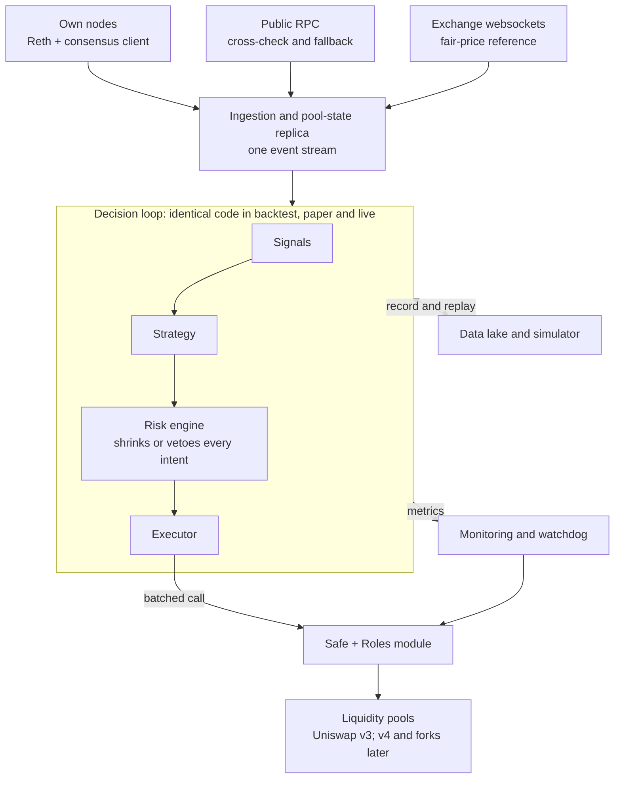

# Autonomous Uniswap v3 LP Bot — Full System Design

Exported from the design doc on 12 November 2026. When the design changes, change this file in the same pull request as the code.

## Summary

Build one Rust workspace with seven swappable modules that automates the play you already run by hand: place liquidity in price zones that get crossed often, enter in the token you value, and leave in that token with fees on top.

The decisions this design makes:

- **The core play is a round trip in your token.** Enter with ETH, or whichever token you value at the time, let the range trade it back and forth, and exit when the position is back in that token plus fees. All results and limits are counted in that token.
- **Blue-chip pools only, ranked by implied volatility.** The universe is WETH, WBTC, USDC and USDT. Pools are ranked by one number built from fee, volume and in-range liquidity.
- **Patience is an adaptive decision.** When price leaves the range, the bot does not recentre and lock in a loss. On each interval it weighs waiting, flipping and closing, using how price has behaved after similar exits on longer timeframes.
- **Every setting is adaptive.** Zone choice, width, fee tier and the patience decision are calibrated by walk-forward backtest, checked in simulation mode, and refined by small live positions.
- **Three run inputs.** Capital, a loss limit in the value token (required), and an autonomy mode: `auto` or `approve`.
- **Run a local node; treat public RPC as a cross-check.** One Ethereum node at home (Reth + a consensus client) covers the first phase and later anchors any L2 node. Public endpoints are rate-limited and cap log queries, so they serve as fallback and sanity check only.
- **Ethereum mainnet first.** Gas there is currently well under a dollar per action, the four tokens have their deepest pools there, and one local node is all it needs. L2s come later.
- **One strategy interface, three run modes.** The same strategy code runs in backtest, paper and live. Every run is defined by a YAML file and shown in one generic viewer.
- **Custody is a Safe with a roles module.** The Safe's owners control withdrawals, and the bot's hot key can only make allowlisted calls within quotas. No custom contract is deployed.
- **Venue-agnostic from day one.** Uniswap v3 is the first adapter. v4 and v3 forks (Aerodrome Slipstream, PancakeSwap v3) plug into the same interface.

This is an engineering design, not financial advice. Adaptive does not mean unbounded: a loss limit in the value token, given as an input to each run, sits under every adaptive decision as a hard backstop.

## The core play

The bot automates one move: put the token you value into a range that price crosses often, collect the fee on each crossing, and take the position out when it is back in that token.

The arbitrage-loss theory from the first draft is out of the decision logic. It remains only as an optional line in the results report.

**A round trip, step by step.** ETH is the value token here, in an ETH/USDC pool.

1. The zone finder picks a price zone that has been crossed often on long lookbacks.
2. The bot places ETH in a range inside that zone, above the current price. There the position is all ETH and needs no swap.
3. Price rises through the range. The pool sells your ETH for USDC and you earn the fee on that volume.
4. Price falls back through the range. The pool buys the ETH back and you earn the fee again.
5. Price is below the range. The position is all ETH again, the same amount as at entry, plus the fees. The bot withdraws, or leaves it in place for the next crossing.

For a different value token the picture mirrors: USDC goes into a range below the price.

**What a crossing pays.** A full pass of price through your range trades your whole position once, whatever other providers are doing. A round trip therefore pays about twice the fee tier on the position: 0.1% in a 0.05% pool, 0.6% in a 0.3% pool. Yield is that figure times round trips per day, which is why the choice of zone matters more than anything else.

Two trade-offs follow, and neither can be settled on paper:

- A narrower range is crossed in full more often, but price also spends more time beyond it.
- A higher fee tier pays more per pass, but its pool price typically moves in coarser steps and completes fewer passes.

**Two ways in.**

| Entry | How | Swap needed | Starts earning | Back in your token |
| --- | --- | --- | --- | --- |
| One-sided (default) | All of the value token in a range on the side price must travel into | No | When price enters the range | When price returns to the entry side |
| Around the price | Swap part into the other token and straddle the current price | Yes, at entry and usually at exit | Immediately | When price falls through the entry-side edge, or by a closing swap |

**The three outcomes of a one-sided ETH entry.**

| What price does | Position ends as | Counted in ETH | Bot's move |
| --- | --- | --- | --- |
| Crosses the range and returns | ETH | Entry amount plus fees | Withdraw, or stay for the next pass |
| Never reaches the range | ETH, untouched | Unchanged; nothing earned | Move closer when the zone map says so |
| Crosses and stays beyond | USDC, sold at about the middle of the range | Less ETH than at entry if bought back now | Patience policy |

**Patience decision (adaptive).** When price ends up beyond the range, nothing is fixed in advance: not the action and not the waiting time. On a set interval the bot compares three actions and takes the one with the best expected result in the value token. It never recentres by reflex.

| Action | What it does | Favoured when |
| --- | --- | --- |
| Wait | Leaves the position in place; it converts back and earns the fee again if price returns | Return odds are high for this distance and this time away |
| Flip | Moves the proceeds into a one-sided range next to the current price, on the side that buys the value token back | A return to the old range looks unlikely, but price is crossing a nearby zone |
| Close | Swaps back to the value token | Return odds are low and no nearby zone pays |

The comparison uses four inputs:

- **Return odds.** From the pool's own history: how often and how fast price came back after being this far beyond a range for this long, in a similar long-horizon state. This is where the longer time ranges enter a short-term position.
- **What a return pays.** The position back in the value token, plus the fee on the pass.
- **What waiting costs.** The yield the same capital would earn in the best zone available now.
- **What switching costs.** Gas, swap fee and price impact.

A switch needs a clear margin over the current course, so the bot does not flip back and forth. Every decision is scored afterwards against what the other two actions would have returned, and that score feeds the calibration below.

Two things stay outside the adaptive part:

- A loss limit in the value token, given as an input to each run. It is the backstop when history stops being a guide, which is exactly when return odds mislead.
- Fixed-rule baselines: always wait, always flip, always close. If the adaptive decision does not beat the best of them out of sample, the bot runs that fixed rule instead.

**Finding the zones.** A high-volatility range becomes something the bot can measure. For each candidate range and each lookback (7, 30 and 90 days) it computes:

- Full passes through the range per day.
- Share of time price spent inside it.
- How long price took to come back after leaving, as a median and a 90th percentile.
- How long a full pass waited for the pass back, as a median and a 90th percentile. This is the wait a position faces once price has run through it.

A full pass is counted when price goes from one side of the range to the other, however long it lingers inside on the way; dipping in and leaving on the same side is a visit, not a pass. Stays outside that the lookback cuts off are kept apart from the ones that ended, so an unfinished wait is never counted as a return.

Inside the top-ranked pools, zones are ranked by passes per day and by the implied volatility of the zone's own liquidity, marked down for long return times. The long lookbacks decide where to stand. The short ones decide when to enter and how long to expect to stay. That is the bot's version of looking at longer price ranges even when going in for a short time.

**How every setting adapts.** No setting is picked by hand or copied from past trades. Zone ranking, width, fee tier, entry shape and the patience margins all go through the same loop:

1. **Backtest.** A calibrator sweeps the settings on history, walk-forward: fit on one window, score on the next, in the value token.
2. **Simulation mode.** Settings that win run on live data with virtual positions.
3. **Live.** Settings that hold up get small real positions side by side. An allocator shifts capital toward what earns most per day, keeping a minimum share on the alternatives so it keeps learning.
4. **Feedback.** Results from simulation and live flow back into the next calibration run, on a schedule.

You can still pin any setting, or freeze the loop.

## Pool universe and ranking

The bot trades only pools whose two tokens are both on a short blue-chip list, and ranks them by implied volatility computed from fee, volume and in-range liquidity.

**Universe.** Four tokens: WETH, WBTC, USDC and USDT. No other wrapped or staked versions count. A pool qualifies only if both of its tokens are on the list. That leaves six pair types: ETH/USDC, ETH/USDT, BTC/USDC, BTC/USDT, ETH/BTC and USDC/USDT, across every fee tier on every configured chain. Pools are discovered from the factory's creation events, so new fee tiers or chains are picked up without a config change. The value token of a campaign is always one of the four.

**Ranking metric.** Implied volatility puts the three things you named into one number:

```latex
IV = 2\sqrt{\frac{f \cdot V}{L\sqrt{P}}}\;\times\;\sqrt{365}
```

| Symbol | Meaning | Where the bot reads it |
| --- | --- | --- |
| f | Fee tier, as a fraction | Pool constant |
| V | Volume per day, in the quote token | Summed from the pool's swap events |
| L | In-range liquidity, not the pool's total | The pool's active `liquidity` at the current tick; per tick from the state replica |
| P | Price, in the quote token | Pool price |

L√P is the in-range liquidity expressed in the quote token. It is about 100 times the value sitting within 1% of the price. An illustration with made-up numbers: a 0.05% pool with 100 million a day of volume and 5 million within 1% of the price has an implied volatility of about 38% a year.

The square of this number is proportional to fees paid per day per unit of in-range liquidity. Ranking by implied volatility is therefore ranking by what the pool pays the liquidity that is actually in range.

**Two versions are computed.**

| Version | Liquidity used | Volume used | Ranks |
| --- | --- | --- | --- |
| At the price | Active liquidity at the current tick | Pool volume over the window | Pools against each other |
| Per zone | Average liquidity across the ticks of the candidate range | Volume traded while price was inside that range, per day inside | Zones inside a pool |

The per-zone version is the one that matches the play, because the position sits in a chosen price range and competes only with the liquidity there.

**Floors before ranking.** A thin pool with a handful of trades shows a huge implied volatility that no real position could collect. Pools must clear a minimum volume and a minimum in-range liquidity first, and the bot caps its own share of the in-range liquidity so its entry does not dilute the number it ranked on. Volume is taken over 7 days as well as 24 hours, so one unusual day does not reorder the list.

**How it feeds the rest.** The ranking picks the pools. Inside the top pools, the zone map picks the ranges, using passes per day and the per-zone implied volatility together. The ranking table, with fee, volume, in-range liquidity and implied volatility side by side for every qualifying pool, is refreshed on a schedule and shown in `lpbot status`.

## Architecture

Seven modules sit in one Rust workspace and talk through a single event stream, so any one of them can be replaced without touching the others.



Data flows down from the three sources into one normalized event stream. The decision loop is the same code in every run mode: in backtest it is fed from the data lake, in paper and live from the nodes. Only the executor differs, and only in live mode does it reach the Safe.

```text
lpbot/
  crates/
    core/        types, config, event bus
    chain/       RpcPool, ExEx and WebSocket ingestion, reorg handling
    venues/      uniswap_v3 (math, state replica, call encoder); later v4, slipstream
    data/        Parquet sinks, exchange feeds, backfill
    sim/         replay engine, cost models, P&L metrics
    strategy/    Strategy trait, signals, gates, range and rebalance policies
    risk/        limits, exit paths
    exec/        planner, simulator, signer client, submitter, journal
    cli/         the lpbot binary
  contracts/     roles policy as code, fork tests; optional vault later
  deploy/        docker-compose, Prometheus, Grafana
  config/        shared base configs (YAML)
  experiments/   one YAML file per experiment or sweep
  viewer/        Grafana dashboards over the result tables
```

Libraries this builds on: alloy for chain types and RPC, revm for local simulation, Reth's ExEx API for in-process ingestion, Polars and DuckDB for result tables, Grafana for viewing. Everything is Rust; there is no Python.

## Node and RPC layer

The first phase needs one machine at home running an Ethereum full node. L2 nodes are added only when the bot expands, and each of them needs this L1 node anyway.

**Why mainnet works as the first chain.** The base fee was about 0.05 gwei in early November 2026 with ETH near 2,300 dollars ([Dwellir](https://www.dwellir.com/blog/ethereum-gas-fees-explained)), and 0.445 gwei on 11 November with ETH at 2,076 dollars ([Etherscan](https://etherscan.io/gastracker)). At the higher of those, a position change of roughly 400,000 gas (my estimate) costs about 0.37 dollars. Gas does move: the daily average ran between 0.46 and 1.9 gwei from mid-August to mid-September 2026 ([CoinLaw](https://coinlaw.io/ethereum-gas-fees-statistics/)). The bot therefore prices gas before each action instead of assuming it stays low.

**Running it at home.** Plan a 4 TB NVMe drive, 32 GB of RAM, a wired connection and a small UPS. That is my sizing: it leaves room beyond Reth's stated full-node minimum for the consensus client, the data lake and growth. Forward only the peer-to-peer ports and never expose the RPC port. A power or internet cut at home leaves the bot blind, so the watchdog must run somewhere else and reach the chain through public endpoints.

| Chain | Client | Disk | RAM | Notes |
| --- | --- | --- | --- | --- |
| Ethereum | [Reth](https://reth.rs/run/system-requirements) + a consensus client | Full ≥ 1.2 TB, archive ≥ 2.8 TB (Reth docs, June 2025). A vendor measured a 2.31 TB archive on Storage V2 ([Dwellir](https://www.dwellir.com/blog/reth-explained)) | 8 GB+ full, 16 GB+ archive | Anchor for all L2 nodes |
| Arbitrum One | [Nitro](https://docs.arbitrum.io/run-arbitrum-node/run-full-node) | Pruned snapshot about 2.3 TB | Docs show a 64 GB machine as the example | Needs an L1 execution RPC and an L1 beacon URL. Has a sequencer feed |
| Base | [base-reth-node + base-consensus](https://github.com/base/node) | Full ≥ 2 TB, archive ≥ 4.1 TB (Reth docs, June 2025) | 32 GB minimum, 64 GB recommended ([Base docs](https://docs.base.org/base-chain/node-operators/performance-tuning)); Reth docs say 128 GB+ | Needs an L1 RPC and an L1 beacon endpoint. Heaviest of the three |

Sizes grow, so check current snapshot sizes before buying disks. Locally attached NVMe is required in practice; network storage falls behind.

**Full or archive.** A pruned full node keeps only recent receipts by default, so it cannot serve years of pool events. Two ways around that:

- Run Ethereum as an archive node and extract history locally with cryo or your reth-db-indexer (MDBX to Parquet). This is the fastest and cleanest backfill.
- Keep full nodes and backfill selected pools once with chunked `eth_getLogs` against public endpoints. It is slow but free, and the result is a static Parquet set you never fetch again.

**In-process ingestion.** Reth Execution Extensions (ExEx) run inside the node binary and receive committed, reverted and reorged chain notifications with receipts and state changes ([Paradigm](https://www.paradigm.xyz/2024/05/reth-exex)). That removes RPC from the hot read path on Ethereum and on Reth-based L2 clients. On Nitro, use the local WebSocket RPC plus the sequencer feed.

**The RPC pool.** All chain access goes through one `RpcPool` component with three tiers:

| Tier | Endpoint | Used for |
| --- | --- | --- |
| 0 | Local node: ExEx, IPC or WebSocket | Every read that feeds a decision; transaction simulation |
| 1 | Second own node, if you add one | Failover |
| 2 | Public endpoints (PublicNode, LlamaRPC, the chains' official RPCs) | Cross-check of head hash and pool price before each transaction; exit-only fallback; one-time backfill |

Rules the pool enforces:

- No decision is made on tier-2 data alone. Public endpoints rate-limit hard, cap `eth_getLogs` block ranges and often disable trace methods ([Chainstack](https://chainstack.com/learn/how-to/how-to-get-ethereum-rpc-endpoint-ai-agents-2026/)). One provider's keyless endpoint allows 2 requests per second per IP ([NodeFlare](https://nodeflare.app/chains)).
- If the local head lags a public head by more than a set number of blocks, the bot enters exit-only mode.
- If tier 0 is down, tier 2 may be used only to withdraw liquidity, with two endpoints agreeing on state.

**Sending transactions.** On Ethereum, submit through a private RPC. Flashbots Protect is permissionless and needs no API key ([benchmark study](https://arxiv.org/html/2505.19708v1)). On L2s, the local node forwards to the sequencer.

**You can defer the hardware.** The research phase runs on public endpoints and free exchange data alone. Buy or rent the node server only after a strategy passes the research gate.

## Data ingestion and storage

Three free streams feed everything: pool events from your node, reference prices from exchange websockets, and block gas data. They land in Parquet for research and Postgres for bot state.

| Stream | Source | Live method | Backfill method | Used for |
| --- | --- | --- | --- | --- |
| Pool events: Initialize, Mint, Burn, Swap, Collect, Flash, protocol-fee changes | Own node | ExEx notifications or `eth_subscribe` logs | cryo, reth-db-indexer, or chunked `eth_getLogs` | Pool state, fee accrual, flow analysis |
| Pool discovery: factory `PoolCreated` | Own node | Same | Same | Pool universe and screening |
| Block headers: base fee, timestamp, L2 data-fee parameters | Own node | New-head subscription | Same extract | Gas cost model |
| Trades and best bid/offer for the same pairs | Binance, Coinbase, OKX public websockets (no key) | Websocket | Exchange bulk history files | Fair price, realized volatility, markouts |
| Own transactions and receipts | Own node | Executor journal | n/a | P&L attribution, reconciliation |

**Pool-state replica.** For each watched pool the ingester keeps an exact in-memory copy of the contract state: `sqrtPriceX96`, tick, active liquidity, net liquidity per initialized tick, global and per-tick fee growth, and the protocol-fee setting. Mint and Burn events update the tick map. Each Swap is replayed through a port of the pool's integer math, which reproduces fee growth across tick crossings exactly. Three safeguards keep it honest:

- A snapshot to disk every few thousand blocks, so restart does not replay from genesis.
- A periodic checksum against on-chain `slot0`, `liquidity` and `ticks()`. A mismatch halts trading on that pool.
- An undo log for recent blocks, driven by the node's reorg notifications. On L2s, track unsafe, safe and finalized heads separately.

Read the protocol-fee setting per pool. Uniswap's fee switch now applies to v2 and select v3 pools, which lowers the LP share there ([The Defiant](https://thedefiant.io/news/defi/uniswap-protocol-revenue-nearly-triples-after-v4-fee-switch-as-uni-tops-usd4)).

**Storage layout.**

| Layer | Technology | Contents |
| --- | --- | --- |
| Raw lake | Parquet, partitioned by chain, pool and day | `events`, `blocks`, `cex_trades`, `cex_bbo` |
| Derived | DuckDB views (ClickHouse and dbt if it outgrows one machine) | `zone_map`, `pool_minute_bars`, `tick_liquidity_snapshots`, `return_times`, `realized_vol` |
| Operational | Postgres | `positions`, `intents`, `tx_journal`, `risk_events`, `strategy_state`, `config_versions` |
| Event bus | In-process channels first; NATS only if modules split into separate processes | Normalized `Event` stream consumed by signals, strategies, risk and monitoring |

**How the raw lake is laid out.** Pool logs are stored raw, with their topics and data and the time of their block, so the replica replays exactly what the chain emitted and a new event type needs no new backfill:

```text
<data>/events/chain=<chain>/pool=<address>/day=<YYYY-MM-DD>/events.parquet
<data>/snapshots/chain=<chain>/pool=<address>/day=<YYYY-MM-DD>.json
```

A day is a UTC day. A finished day is written once and never touched again; the day in progress is kept as `events.partial.parquet` and rewritten by the next backfill, so a re-run fetches only what is new. The snapshot for a day is the pool's full state right before that day's first block, the point every replay starts from. Reading a range of days fails on a missing day, so a gap is never mistaken for a quiet day.

**The table that matters most: the zone map.** For each pool it holds a grid of candidate ranges by lookback, with full passes per day, share of time in range, and the spread of return times after price leaves. It is updated incrementally from pool prices and drives zone choice and the patience policy. Markouts and arbitrage-loss figures can be added later as diagnostics; nothing depends on them.

## Simulation and backtesting

The backtester replays real pool events through the same pool math and the same strategy code that run live, and inserts your position as a virtual one. If the simulator is wrong, everything downstream is wrong, so it is validated against real positions before any strategy result is trusted.

How a run works:

1. Load the pool snapshot at the start block and the event stream for the window.
2. Apply each block's events in log order. After each block, pass the state to the strategy.
3. Execute any action the strategy returns at a later block (latency parameter, at least one block), at the state then. This prevents look-ahead.
4. Accrue fees to the virtual position from the change in fee growth inside its range, times its liquidity. In practice the position takes its pro-rata share of each swap step's fee, which is the same quantity.
5. Charge costs: gas for each action (plus the L1 data fee on L2s), swap fee and price impact for rebalance swaps, and the pool's protocol fee. Swaps are run against a copy of the pool, so fee and impact are exact. Gas is charged at the price in the `costs` block for now; historical gas prices follow once block headers are stored.
6. Mark the position each block and write the P&L breakdown. The mark is the pool's own price after its swap fee for now; the exchange mid-price replaces it when the exchange feeds exist.

**Two fill models.** *Passive* assumes your liquidity is small against active liquidity, so historical swaps are unchanged and you take a pro-rata fee share. *Impact* re-runs swaps with your liquidity added and regenerates arbitrage flow from the exchange price path. Use passive first. Switch to impact once your size exceeds a few percent of active liquidity in the range.

**What the first version trades.** The zone round trip with the three fixed patience rules, on one pool per run:

- *Pool.* The stored pool holding the value token that ranks highest by implied volatility over the week before the window, unless the strategy names a `pool`.
- *Entry.* One-sided in the value token, in a range of the run's width within `entry.max_gap_ticks` of the price (one width by default). Among those ranges it takes the one crossed most on the longest lookback, provided it was also crossed on the shortest. Without a day of history it takes the nearest.
- *Staying.* A position that is back in the value token stays for the next pass. It moves only when price has drifted further than the gap allows, or when another range is crossed `entry.move_margin` times as often (1.5 by default).
- *Beyond the range.* Every `patience.decide_every` the rule answers: wait, flip into the range next to the price, or close. A flipped position that price leaves behind by a full width gets the same question again.
- *Loss limit.* Checked on every block against the run's starting capital, position marked at the pool price. When hit, everything is closed and the run stops.

All of these are the fixed starting point the calibrator has to beat, not tuned choices.

**Outputs per run.** Per campaign and in total, counted in the value token: amount in, amount out, fees, days held, passes completed, time spent beyond the range, gas and swap cost. Each run is compared with simply holding the value token. An arbitrage-loss figure is available as an optional diagnostic.

**Calibration, not hand-tuning.** A calibrator reruns the simulator on a schedule across the search space of settings: zone ranking weights, width, fee tier, entry shape and patience margins. It fits on one window and scores on the next. A setting is promoted to simulation mode only if it beats both the one currently running and the fixed-rule baselines on the scoring window. Simulation mode (`paper` in the config) then runs it on live data before any capital follows.

**Validation, in order of importance.**

- Reproduce the fees actually collected by at least 20 real historical positions in the pool, to within 0.1%. `lpbot verify-fees` does this from the stored logs: it follows every position that starts empty inside the history, adds up what the replica's fee growth says the pool owed it, and compares that with its `Collect` events.
- Differential-test the math port against the deployed pool on a local fork (revm or anvil) with randomized swaps and mints.
- Walk-forward only: fit parameters on one window, score on the next. Never report in-sample results.
- Choose pools by a rule fixed in advance, not by looking at which pools did well.

**Paper mode.** The same engine runs on the live event stream with virtual positions and real gas quotes. Its P&L is the yardstick for the live bot later: live results that drift from paper results mean an execution or modeling fault.

## Strategy framework

A strategy only declares the positions it wants; sizing limits, transaction building and safety live outside it. That separation is what makes strategies small, testable and swappable from config.

```rust
pub trait Strategy: Send {
    fn id(&self) -> &str;
    fn subscriptions(&self) -> Vec<Feed>;                  // pools, exchange symbols, timers
    fn on_event(&mut self, ctx: &Ctx, ev: &Event) -> Vec<Intent>;
}

pub enum Intent {
    SetPositions { pool: PoolId, targets: Vec<RangeTarget> },   // desired end state
    Exit { pool: PoolId, reason: ExitReason },
    Hedge { venue: VenueId, symbol: Symbol, target_delta: f64 },
}

pub struct RangeTarget { pub tick_lower: i32, pub tick_upper: i32, pub weight: f64 }
```

Intents are declarative. The strategy says "these ranges with these weights"; the planner diffs that against on-chain positions and produces the minimal set of actions. A restart therefore needs no memory: read the chain, ask the strategy, diff.

**Campaigns.** The unit the bot manages is a campaign: one entry, the fees it collects and its exit, all valued in one token. Each campaign records its zone, width, fee tier and entry shape. That record is what the live allocator learns from.

**The patience decision is its own plug-in.** The adaptive version and the fixed rules implement the same small interface, so they can be compared like for like in backtest and swapped in config.

```rust
pub trait PatiencePolicy: Send {
    fn decide(&self, campaign: &Campaign, market: &MarketView) -> PatienceAction;
}

pub enum PatienceAction { Wait, Flip { target: RangeTarget }, Close }
```

**Building blocks.** Most strategies are a composition of five small parts, each selectable in config:

| Block | Decides | Examples |
| --- | --- | --- |
| Signal | A number from data | Passes per day through a zone, return odds, long-horizon band |
| Gate | Whether to open a campaign now | Zone still active on the long lookback; no event window |
| Range policy | Where and how wide | One-sided range in the top-ranked zone; a ladder of ranges |
| Patience policy | What to do when price is beyond the range | Adaptive choice between wait, flip and close; the three fixed rules as baselines |
| Sizer | How much capital | Share set by the live allocator; fixed campaign size |

**Signals to build first.**

| Signal | Computed from | Drives |
| --- | --- | --- |
| Zone map: full passes per day through each candidate range, on 7, 30 and 90 day lookbacks | Pool price history | Where to place ranges |
| Return odds: chance and speed of return, given distance beyond the range and time already away | Pool price history | The patience decision |
| Long-horizon band: the price range that has held over the long lookback | Exchange or pool price | Which slice of history the return odds are read from |
| Where price sits relative to the zone right now | Live price | Entry timing and side |
| Best available zone yield | Zone map | Cost of waiting; flip target |
| Value-token yield per day of each campaign | Own positions | Live allocation; calibration feedback |
| Exchange-to-pool price gap | Pool price against exchange mid | Pause entries while the pool is stale |
| Entry and exit cost | Gas, swap fee, price impact | Cost of switching; minimum campaign size |
| Event calendar | A static file of macro releases and token unlocks | Hold off new entries |
| Implied volatility, at the price and per zone | Fee tier, volume, in-range liquidity | Pool ranking; zone ranking |

**Strategy catalogue.**

| Strategy | Idea | Pays when | Main risk |
| --- | --- | --- | --- |
| Zone round trip (primary) | One-sided range in a high-crossing zone; in and out in the value token; patience policy when price runs beyond | Price keeps crossing the zone | Price leaves and does not return |
| Zone ladder | Several adjacent narrow one-sided ranges across the zone | Partial moves still complete passes on the nearer rungs | More transactions |
| Around-price range | Straddle the current price after a partial swap | Price chops around the entry | Swap costs; ends in the other token on a trend |
| Correlated-pair tight range | Very tight range on USDC/USDT | Price barely moves | Depeg |
| Wide static | One wide range, never moved | Baseline for comparison | Low fees per day |
| Hedged variant | Any of the above plus a perp position | You want the value token's exposure held constant | Hedge cost, exchange risk |

The rule common to all of them: a position that is out of range is left alone unless its patience policy says otherwise. The bot never recentres just because price moved.

## Risk engine and limits

Every intent passes through a risk engine that can only shrink or veto it, and three independent paths can pull all liquidity. Full autonomy is acceptable only because of this layer.

| Layer | Check | Action on breach |
| --- | --- | --- |
| Pre-trade | Notional per pool, per chain and in total | Shrink to the cap |
| Pre-trade | Minimum range width in ticks | Veto |
| Pre-trade | Pool price within a set distance of exchange mid and of the pool's own time-weighted price | Veto; retry next block |
| Pre-trade | Slippage bound on the swap leg | Veto |
| Pre-trade | Gas cost below a set share of expected fees over the horizon | Defer |
| Pre-trade | Rebalances per pool per day | Veto until the window resets |
| Portfolio | Loss counted in the value token over a rolling window | Exit and pause the strategy |
| Portfolio | Inventory skew per token | Block actions that add to the skew |
| Market | Price breaks the long-horizon band | Force a fresh patience decision at once |
| Market | Depeg distance on correlated pairs | Exit and pause the pool |
| Market | Exchange feed stale | No new entries |
| Infrastructure | Local node behind public head | Exit-only mode |
| Infrastructure | Pool-state checksum mismatch | Halt the pool |
| Infrastructure | Transaction pending too long | Replace with higher fee, up to the gas cap |

The three exit paths:

1. **Automatic.** Any breach above marked exit withdraws that pool's positions.
2. **Operator.** One CLI command or chat command runs `exit-all` and sets the global pause flag.
3. **Watchdog.** A second small process on a different machine and provider holds a key that can call only `exitAll()`. It fires when the bot's heartbeat stops. A narrow range left unattended is the worst case of this system, and this path covers it.

Thresholds are config values, calibrated from the backtest per pool, and versioned so every live decision can be traced to the limits in force.

The loss limit is the exception. It is a required input to every run, with no default, and the autonomy mode given with it decides whether flips and closes need your approval.

One limit no software fixes: if an L2 sequencer is down, nobody can move. Size positions on each chain with that in mind.

## Execution

The executor turns the difference between target and current positions into one batched Safe transaction per pool, and gets it included privately and within a gas budget.

1. **Plan.** Diff target ranges against on-chain positions. Compute exact token amounts with integer math. If the token ratio is wrong for the new ranges, solve for the swap size by simulating the swap on the state replica.
2. **Simulate.** Run the full call with revm or `eth_call` against the local node's latest state. Reject it if resulting balances differ from the plan.
3. **Bound.** Encode the expected tick, a price limit for the swap, minimum amounts and a deadline into the call, so the contract reverts if the pool moved.
4. **Sign.** A separate signer process holds the keeper key and signs only calls that go through the roles module.
5. **Submit.** Ethereum: private RPC. L2: local node to sequencer.
6. **Track.** Journal intent, transaction hash and receipt. Manage nonces. Escalate the fee on a stuck transaction up to the risk engine's cap.
7. **Reconcile.** After confirmation, read positions back from the chain and compare with the plan. On restart, the chain is the source of truth, never local memory.

**Gas policy.** EIP-1559 fees with a cap set by the risk engine. On L2s the estimate includes the L1 data fee. Routine recentring waits for cheap blocks; exits ignore the cap.

**MEV exposure and what covers it.**

| Chain | Exposure | Mitigation |
| --- | --- | --- |
| Ethereum | The swap leg can be sandwiched from the public mempool. A mint at a manipulated price can be exploited | Private submission ([Flashbots Protect](https://docs.flashbots.net/flashbots-protect/overview) hides transactions from the public mempool); on-chain tick and price bounds |
| Arbitrum | No public mempool. Non-express transactions are delayed 200 ms under [Timeboost](https://docs.arbitrum.io/launch-arbitrum-chain/features/common/mev/choose-timeboost), and two firms have won over 90% of express-lane rounds ([Messias and Torres](https://arxiv.org/html/2509.22143v1)) | Nothing needed for safety; accept that arbitrageurs are faster and price it in through the gate |
| Base and other OP Stack chains | No public mempool; sequencer orders by priority fee | On-chain bounds only |

The bot never needs to be fast. Its decisions run on a seconds-to-minutes horizon, so being one block late costs little if the on-chain bounds are tight.

## Smart contracts

Custody is a Safe with the Zodiac Roles module, and no custom contract is deployed. The executor still reaches it through a `Custody` interface, so a vault could be added later without touching strategy code.

**Safe or vault.**

| Aspect | Safe + Roles module | Custom vault |
| --- | --- | --- |
| Code you write | None on-chain; a permissions policy kept as code | A few hundred lines of Solidity |
| Review status | Safe is long-established; Roles v2 was audited by G0 Group and Omniscia ([Balancer forum](https://forum.balancer.fi/t/bip-xxx-roles-v2-migration-new-treasury-permissions/5742)) | Yours to test and have reviewed |
| What the hot key can do | Only allowlisted calls: target, function, conditions on arguments, and quotas ([Roles docs](https://zodiac-roles-docs-2ovnznd37-gnosis-guild.vercel.app/general/conditions)) | Only `rebalance`, `exit` and `collect` |
| Can a leaked hot key take funds out | No, if every recipient is pinned to the Safe | No |
| Can a leaked hot key lose money through bad trades | Yes, up to the quotas. Checks are on call arguments, not on the pool price or the outcome | Bounded on every call: tick against time-weighted tick, swap cap, value-after check |
| Atomic position change | A MultiSend batch, each inner call checked on its own ([Roles docs](https://zodiac-roles-docs-a5t7pw8sh-gnosis-guild.vercel.app/general/unwrapping)) | One call, checked as a whole |
| Gas per action | Higher: Safe and Roles overhead, plus the position manager's NFT | Lower: direct pool calls, no NFT |
| Stepping in by hand | Easy: Safe app, positions show in the Uniswap interface | CLI or block explorer |
| Changing the rules | Owner edits the policy | Deploy a new vault and move funds |
| Adding venues (v4, forks) | Add permissions | New vault or adapter |
| Main way it goes wrong | A permission written too broadly | A bug in your own contract |
| Time to first live run | Days | Weeks, plus review |

**Decision: Safe.** The core play is mostly mint, burn and collect with no swap, which is the case where argument-level permissions come closest to being enough. Mainnet gas is low enough that the overhead does not matter. There is no contract to write or review, and you can take over by hand from the Safe app at any time.

**Covering the Safe's weak row.** A leaked hot key cannot withdraw, but it can trade badly until a quota stops it. With no on-chain price check, the cover is layered:

- **Tight quotas.** Daily caps on swap volume and on the number of position changes, sized to the run's capital. Swaps are needed only for a close or an around-price entry, so the swap quota can be small.
- **Narrow scope.** Only the four universe tokens, only the two Uniswap contracts, recipient always the Safe.
- **Key handling.** The keeper key sits in a separate signer process and its wallet holds gas money only.
- **Fast revocation.** The Safe's owners can remove the keeper role in one transaction, and the watchdog can pull liquidity without the keeper.
- **Private submission.** Anything containing a swap goes through a private RPC.
- **Bot-side checks.** The executor still simulates every transaction and compares the pool price with the reference price. These stop the bot's own mistakes, not a thief holding the key.

**Roles on the Safe.**

| Role | Held by | Allowed calls | Limits |
| --- | --- | --- | --- |
| Owner | The Safe's signers, on hardware wallets | Everything, including withdrawals and policy changes | Signature threshold |
| Keeper | Bot hot key | Position manager: mint, increase, decrease, collect. Router: single-pool swap. Token approvals to those two contracts | Recipient fixed to the Safe; tokens limited to WETH, WBTC, USDC, USDT; daily quotas |
| Watchdog | Machine outside your home | Position manager: decrease and collect | Recipient fixed to the Safe |

The policy is kept as code in the repository and applied by the owners. Fork tests assert that every call outside the allowlist is rejected before any funds go in.

**Vault, for reference only.** Nothing in the build plan depends on a vault. The specification below is kept in case position size later makes on-chain price checks worth a custom contract.

**Roles.**

| Role | Held by | Can do |
| --- | --- | --- |
| Owner | Hardware wallet or Safe multisig | Deposit, withdraw, set keeper and watchdog, set guards, allowlist pools, pause |
| Keeper | Bot hot key | `rebalance`, `exit`, `collect` |
| Watchdog | Second machine | `exitAll` only |

**Interface sketch.**

```solidity
struct Range { int24 lower; int24 upper; uint128 liquidity; }

struct RebalanceParams {
    address pool;
    Range[] burn;               // positions to remove; fees are collected with them
    bool zeroForOne;            // swap direction; swapAmountIn = 0 skips the swap
    uint256 swapAmountIn;
    uint160 sqrtPriceLimitX96;
    Range[] mint;               // positions to add
    int24 expectedTick;         // revert if the pool tick is further away than the tolerance
    uint256 deadline;
}

interface ILPVault {
    function rebalance(RebalanceParams calldata p) external;                 // keeper
    function exit(address pool) external;                                    // keeper
    function exitAll() external;                                             // keeper or watchdog
    function withdraw(address token, uint256 amount, address to) external;   // owner
    function setGuards(address pool, Guards calldata g) external;            // owner
    function setPaused(bool paused) external;                                // owner
}
```

**Guards the vault enforces on every rebalance.**

- The pool is on the owner's allowlist, and callbacks are accepted only from that pool.
- The pool tick is within tolerance of both the keeper's `expectedTick` and the pool's own time-weighted tick.
- The swap is capped as a share of vault value and bounded by the price limit.
- Vault value after the call, priced at the time-weighted tick, is no lower than before minus a small allowance.
- A minimum interval has passed since the last rebalance, and the deadline has not.

**Design rules.**

- Call the pool's `mint`, `burn`, `collect` and `swap` directly and implement the two callbacks. This is cheaper than the position manager and creates no NFT.
- No upgradeability, no delegatecall, no arbitrary external calls. To change logic, deploy a new vault and have the owner move funds.
- Plain ERC-20 tokens only. No fee-on-transfer or rebasing tokens.
- One small vault per venue type (v3-style pools, v4 pool manager) sharing a guard library, not one large adapter contract.

**Testing before funds.** Foundry unit, fuzz and invariant tests, with two invariants above all: only the owner can move tokens out, and no keeper call can reduce vault value by more than the allowance. Then fork tests on each chain, an independent review, and a deposit cap in the first weeks.

A caveat on the time-weighted guard: on thin pools it can be manipulated and may need more oracle observations enabled. The keeper's `expectedTick` plus private submission is the second line of defence, not a redundancy.

## Configuration and setup

One YAML file declares chains, pools, strategies and limits. Adding a pool or changing a strategy is a config edit; adding a new strategy type or venue is one trait implementation.

The numbers below are placeholders to show the shape, not recommended values.

```yaml
mode: paper            # backtest | paper (simulation on live data) | live

run:                   # inputs to each run; flags on the command line override these
  capital_usd: null    # required: what this run may deploy
  loss_limit_pct: null # required, no default: the run refuses to start without it
  autonomy: approve    # auto | approve

chains:
  arbitrum:              # added later; Ethereum mainnet runs first
    rpc:
      local: ws://127.0.0.1:8548
      feed: wss://arb1.arbitrum.io/feed
      public: [https://arb1.arbitrum.io/rpc]
      max_head_lag_blocks: 20
    submit: sequencer
    custody: { kind: safe_roles, safe: "0x...", roles: "0x..." }
  ethereum:
    rpc:
      local: /data/reth/reth.ipc
      public: [https://ethereum-rpc.publicnode.com, https://eth.llamarpc.com]
      max_head_lag_blocks: 2
    submit: https://rpc.flashbots.net/fast
    custody: { kind: safe_roles, safe: "0x...", roles: "0x..." }

universe:
  tokens: [WETH, WBTC, USDC, USDT]          # blue chips only; both tokens of a pool must be listed
  venues: [uniswap_v3]
  fee_tiers: all
  floors:
    volume_usd_per_day: 5000000             # 7-day average
    in_range_liquidity_usd: 1000000         # within 1% of the price
  max_share_of_in_range_liquidity: 0.05

ranking:
  metric: implied_vol          # from fee, volume and in-range liquidity
  liquidity: in_range          # at the current tick, and per candidate zone
  volume_windows: [24h, 7d]
  refresh: 1h
  top_pools: 4

reference_prices:
  ETH-USD: [binance:ETHUSDC, coinbase:ETH-USD]
  BTC-USD: [binance:BTCUSDC, coinbase:BTC-USD]

strategies:
  - id: eth-zone-roundtrip
    kind: zone_round_trip
    value_token: WETH                 # one of the universe tokens; change it any time
    pools: ranked                     # top pools holding the value token; fee tier follows the ranking
    capital_share: 0.25
    zone:
      lookbacks: [7d, 30d, 90d]
      rank_by: [passes_per_day, zone_implied_vol]
    entry:
      shapes: [one_sided, around_price]
      width_ticks: { min: 10, max: 80 }          # search space, not a choice
    patience:
      mode: adaptive                  # or a fixed rule: wait | flip | close
      decide_every: 1h
      switch_margin: calibrated       # or a fixed percentage
    allocator:
      campaign_size_usd: 500
      min_explore_share: 0.2          # capital kept on non-leading settings

calibration:
  method: walk_forward
  fit_window: 90d
  score_window: 14d
  rerun: weekly
  promote: beats_current_and_fixed_rules   # otherwise keep what is running
  pinned: {}                               # settings you fix by hand, if any

risk:
  max_notional_usd: { per_pool: 20000, per_chain: 50000, total: 80000 }
  max_actions_per_day: 12
  max_swap_slippage_bps: 8
  max_pool_vs_reference_bps: 15
  loss_window: 30d                    # window over which run.loss_limit_pct is measured
  heartbeat_timeout: 90s
```

**Commands.**

| Command | Does |
| --- | --- |
| `lpbot backfill --pool <address> --from <date>` | Pulls history into the Parquet lake: one file per pool and day, plus a snapshot of the pool before the first day. `--verify` replays what is stored and compares it with the pool on the chain |
| `lpbot verify-fees <address>` | Compares the replica's fees with what real positions in the stored history collected |
| `lpbot rank` | Ranks the stored pools by implied volatility (`--node` reads the node instead) |
| `lpbot zones <address>` | Shows a pool's zone map from the stored history (`--node` reads the node instead) |
| `lpbot demo-data` | Writes a simulated pool history into its own folder, to try the pipeline before the node is synced |
| `lpbot run <experiment.yml>` | Runs one experiment file, or every run of its sweep, on the stored history and writes the result tables. Backtests with the fixed patience rules run today |
| `lpbot paper` --loss-limit \<pct> --autonomy \<mode> | Runs on live data with virtual positions |
| `lpbot live` --loss-limit \<pct> --autonomy \<mode> | Runs with real funds through the Safe |
| `lpbot status` | Positions, P&L breakdown, limits, node health |
| `lpbot exit-all` | Withdraws all liquidity and pauses |

**Run inputs.** Two things are given per run, on the command line or in the `run` block, and are recorded with the run's results.

- `--loss-limit <pct>`: the most the run may lose, counted in the value token over the loss window. It is required and has no default. When it is hit, the bot exits everything and pauses. It applies in backtest, simulation and live alike, so a limit can be tried on history before it is used with funds.
- `--autonomy <auto|approve>`: how much the bot does without you.

| Mode | Bot does alone | Needs your OK | If you do not answer |
| --- | --- | --- | --- |
| `auto` | Everything | Nothing | Not applicable |
| `approve` | Opens campaigns, waits, collects fees | Any flip or close chosen by the patience decision | Keeps waiting and asks again at the next decision |

In `approve` mode the request arrives in the chat channel with the three options and their expected results, and one reply settles it. Safety exits never ask in either mode: the loss limit, the watchdog and the infrastructure checks act at once. Backtests always run as `auto`; simulation mode honours `approve`, so you can see what the bot would ask before it holds funds.

**Capital is the third run input.** `--capital <amount>` sets what the run may deploy; the bot splits it into campaigns. At current mainnet gas the smallest sensible campaign is small, so capital mainly decides how many campaigns run side by side. The one place size changes behaviour is the cap on the bot's share of in-range liquidity.

**First-time setup.**

1. `docker compose up` for the nodes, Postgres, Prometheus and Grafana; wait for sync.
2. Backfill the candidate pools and exchange history.
3. Backtest, then run paper mode.
4. Create the Safe, enable the roles module, apply the policy, and assign the keeper and watchdog roles.
5. Deposit a capped amount and switch `mode` to `live`.

**Extension points.**

- New strategy: implement `Strategy`, or compose existing gate, range and patience blocks in YAML.
- New venue (v4, Slipstream): implement the `Venue` trait, which supplies the state replica, the math and the action encoder.
- New chain: one config block plus a Safe with the same policy.

## Experiments and results

Every run, whether backtest, simulation or live, is defined by one YAML file and writes the same result tables, so a single viewer shows all of them. There are no notebooks and no Python anywhere in the system.

**An experiment file.** It points at a shared base config and states only what this experiment changes. An optional `sweep` block expands into one run per combination.

```yaml
experiment: width-and-patience-eth
base: config/mainnet.yml            # chains, universe, ranking, risk
mode: backtest                      # backtest | paper | live
window: { from: 2026-05-01, to: 2026-10-31 }
run: { capital_usd: 10000, loss_limit_pct: 5, autonomy: auto }
strategy: eth-zone-roundtrip
sweep:
  entry.width_ticks: [10, 20, 40, 80]
  patience.mode: [adaptive, wait, flip, close]
```

`lpbot run experiments/width-and-patience-eth.yml` executes it. Each run stores its fully resolved config, a hash of it, and the code version. The same file, data and code version give the same result.

**What every run writes.**

| Table | One row per | Holds |
| --- | --- | --- |
| `runs` | Run | Config hash, code version, mode, window, run inputs, headline results in the value token |
| `campaigns` | Campaign | Pool, zone, width, fee tier, entry and exit, amount in and out, fees, days held |
| `decisions` | Patience decision | The three options with their expected results, the choice, and how it turned out |
| `series` | Run and time step | Price, position value in the value token, value if held, cumulative fees, in or out of range |
| `pool_rank` | Pool and refresh | Fee, volume, in-range liquidity, implied volatility |
| `zone_map` | Pool, zone and lookback | Passes per day, time in range, return odds |

Tables are written as Parquet per run, as `<results>/<table>/<run id>.parquet` with a `run_id` column in every table, and loaded into Postgres for viewing, with the time series thinned for display. Full resolution stays in Parquet.

**The viewer.** It is generic because it knows only these tables, never a particular experiment. A new strategy or sweep needs no new charts. My choice is Grafana, since it is already in the stack for monitoring; a small web page served by the bot itself is the alternative if you prefer no extra tool.

| View | Shows |
| --- | --- |
| Runs | Any set of runs side by side on headline results; a sweep as a grid of setting against result |
| Run detail | Price with the ranges and campaign entries and exits drawn on it; value in the value token against holding; cumulative fees |
| Decisions | Each patience decision with its three options, what was chosen and what happened next |
| Pools and zones | The ranking table through time; the zone map as a heat map |
| Live | The same views on the running bot, plus node and safety status |

Backtest, simulation and live runs appear in the same views, so a live run can be laid directly over the simulation it came from.

## Operations

Everything runs from one Docker Compose file on the machine at home, plus the watchdog on a small machine somewhere else. All tooling is open source and free.

**Services.** Ethereum execution and consensus clients, one L2 node per chain, the bot (ingest, engine, executor as one binary at first), the signer, Postgres, Prometheus, Grafana and Alertmanager.

**Keys.**

- The owner key never touches the server. Use a hardware wallet or a Safe.
- The keeper key lives in an encrypted keystore, loaded only by the signer process. The signer signs calls that go through the roles module and nothing else.
- The keeper wallet holds gas money only. If it leaks, the attacker can act inside the allowlist and quotas but not withdraw. The owner rotates it with one transaction.

**What to watch.**

| Area | Metrics | Alert when |
| --- | --- | --- |
| Strategy | Fees, result in the value token, passes completed, time beyond the range | Drawdown limit near; live P&L diverges from paper |
| Execution | Rebalances per day, gas spent, revert rate, time to inclusion | Reverts repeat; a transaction is stuck |
| Data | Head lag, replica checksum, exchange feed age | Any breach of the risk engine's infrastructure checks |
| Node | Peers, disk free, sync status, client version | Disk under 15% free; node not at head |
| Safety | Heartbeat, pause flag, risk events | Heartbeat missed; any exit triggered |

Alerts go to a chat channel you already use; the same channel accepts the `exit-all` command.

**Routine work the bot does not remove.**

- Client upgrades. Releases are frequent (Reth shipped v2.10.1 on 6 November 2026, per [Dwellir](https://www.dwellir.com/blog/reth-explained)), and L2 hard forks halt nodes that miss them. Pin versions and subscribe to release feeds.
- Disk growth. Re-check sizes monthly.
- A ledger export of every mint, burn, swap and fee collection, for accounting and tax.
- A runbook for each of: node out of sync, stuck transaction, depeg, suspected key leak.

## Build plan

Six phases, each with a gate. The path to small live trials is deliberately short, because width and fee tier are settled there and not on paper.

1. **Pool ranking, zone map and simulator.** Build the pool ranking for the blue-chip universe on Ethereum mainnet and backfill prices and events for its top pools. Build the zone map and the return-odds tables. Port the v3 math and the replay engine. Set up experiment files, the result tables and the viewer.
   - Gate: fees of real on-chain positions in those pools reproduced within 0.1%.
2. **Adaptive policy in backtest.** Implement the zone round trip with the three fixed patience rules, then the adaptive decision and the calibrator.
   - Gate: scored walk-forward in the value token, the adaptive decision beats the best fixed rule. If it does not, the fixed rule ships and the adaptive one keeps running in the background.
3. **Simulation mode.** Live data, virtual campaigns, calibrator on its schedule. Public endpoints are enough until the local node is synced.
   - Gate: a few weeks of simulated campaigns in line with the walk-forward scores.
4. **Custody, executor and local node.** Set up the Safe and its roles policy. Write the planner, signer and submitter, and run full campaigns on a local fork. Bring up the Ethereum node at home alongside.
   - Gate: fork tests show the roles policy rejects every call outside the allowlist; exit paths demonstrated on the fork; a week on the local node with no state-checksum failure.
5. **Live trials.** Ethereum mainnet, small campaigns side by side, capped in total, allocator and calibrator both running.
   - Gate: live results track simulation; all three exit paths exercised once in production.
6. **Scale out.** Larger campaigns, L2 chains, the v4 and Slipstream adapters.

Real funds first move in phase 5, and only in campaign-sized amounts.

## Risks and open decisions

The largest risk is the one the patience rule exists for: price leaves a range and does not come back while the bot is holding the other token.

| Risk | Why it matters | What limits it |
| --- | --- | --- |
| Price does not return | The position ends in the other token while your value token rallies | Adaptive patience decision with a loss limit as backstop; campaign size caps; small live trials first |
| Roles policy too broad | A loose permission lets the hot key do more than intended | Policy kept as code; fork tests that every call outside the allowlist fails; tight quotas |
| Keeper key leak | Attacker can trade badly up to the quotas | Tight quotas; private submission; owners remove the role in one transaction |
| Single server | Node or host failure leaves a narrow range unattended | Watchdog on a second provider; exit-only fallback through public RPC |
| Sequencer outage on an L2 | No one can transact | Per-chain size caps |
| Token events | Depeg; issuer freezing the vault address on USDC or USDT | Depeg breaker; diversify the quote asset |
| Protocol drift | Fee switch on v3 pools; liquidity moving to v4, which holds 33.5% of Uniswap TVL against 48.7% for v3 ([Blockworks](https://blockworks.com/insights/uniswap-data-dashboard-primer)) | Per-pool protocol-fee read; venue adapters |
| Tax and regulation | Each rebalance may be a taxable disposal | Ledger export; professional advice for your jurisdiction |
| Adaptive settings fitted to the past | History misleads most at a break in market behaviour, which is when the patience decision matters most | Walk-forward scoring; fixed-rule baselines; simulation before capital; the loss limit |

No decisions are open. The next step is phase 1 of the build plan.

## Sources

- [Reth system requirements](https://reth.rs/run/system-requirements)
- [Reth explained](https://www.dwellir.com/blog/reth-explained) — Dwellir
- [Reth Execution Extensions](https://www.paradigm.xyz/2024/05/reth-exex) — Paradigm
- [Ethereum gas fees explained](https://www.dwellir.com/blog/ethereum-gas-fees-explained) — Dwellir
- [Ethereum gas tracker](https://etherscan.io/gastracker) — Etherscan
- [Ethereum gas fees statistics 2026](https://coinlaw.io/ethereum-gas-fees-statistics/) — CoinLaw
- [Zodiac Roles: conditions](https://zodiac-roles-docs-2ovnznd37-gnosis-guild.vercel.app/general/conditions) and [transaction unwrapping](https://zodiac-roles-docs-a5t7pw8sh-gnosis-guild.vercel.app/general/unwrapping) — Gnosis Guild
- [Roles v2 migration and audits](https://forum.balancer.fi/t/bip-xxx-roles-v2-migration-new-treasury-permissions/5742) — Balancer forum
- [Run a full node](https://docs.arbitrum.io/run-arbitrum-node/run-full-node) — Arbitrum docs
- [Timeboost](https://docs.arbitrum.io/launch-arbitrum-chain/features/common/mev/choose-timeboost) — Arbitrum docs
- [The Express Lane to Spam and Centralization](https://arxiv.org/html/2509.22143v1) — Messias and Torres
- [Base node repository](https://github.com/base/node) and [Base node performance tuning](https://docs.base.org/base-chain/node-operators/performance-tuning)
- [Flashbots Protect overview](https://docs.flashbots.net/flashbots-protect/overview)
- [Private MEV Protection RPCs: Benchmark Study](https://arxiv.org/html/2505.19708v1)
- [How to get an Ethereum RPC endpoint (2026)](https://chainstack.com/learn/how-to/how-to-get-ethereum-rpc-endpoint-ai-agents-2026/) — Chainstack
- [Public endpoints](https://nodeflare.app/chains) — NodeFlare
- [Uniswap data dashboard primer](https://blockworks.com/insights/uniswap-data-dashboard-primer) — Blockworks
- [Uniswap protocol revenue after the v4 fee switch](https://thedefiant.io/news/defi/uniswap-protocol-revenue-nearly-triples-after-v4-fee-switch-as-uni-tops-usd4) — The Defiant
